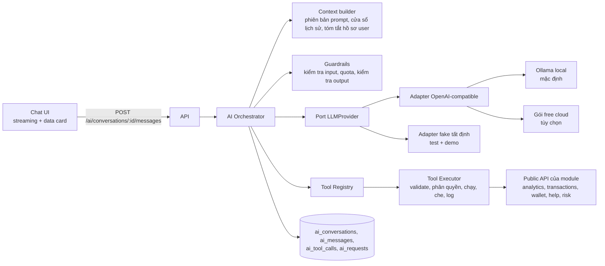

# Trợ lý tài chính AI — Kiến trúc, tool và an toàn

| Mục | Giá trị |
|---|---|
| Trạng thái | Bản nháp chờ duyệt (Phase 0). Đã cập nhật theo quyết định của chủ dự án: **chỉ dùng model miễn phí**. |
| Cập nhật | 2026-11-21 |
| Liên quan | [ADR-0009](../adr/0009-ai-orchestration.md), [Bảo mật](security.md), [API](../api/api-spec.md#10-ai) |

## 1. Mục tiêu và giới hạn cứng

Trợ lý giải thích, phân tích và hướng dẫn, **chỉ dùng dữ liệu do tool backend trả về**. Trợ lý chỉ đọc.

Trợ lý không thể: chuyển tiền, nạp, rút, thanh toán, hoàn tiền, đổi số dư hay bản ghi, mở khóa ví, đổi hạn mức, phê duyệt bất kỳ việc gì, hoặc vượt qua risk rule. Điều này được đảm bảo bằng **kiến trúc** (registry không có tool nào như vậy), không chỉ bằng prompt.

Không có chi phí: mọi model dùng trong dự án là miễn phí. Không có khóa API trả phí nào trong cấu hình.

## 2. Thành phần

- **Port LLMProvider**: `stream_chat(system, messages, tools, config) -> AsyncIterator[LLMEvent]` với event đã chuẩn hóa (text delta, tool call, usage, finish reason, lỗi). Code nghiệp vụ không import SDK của nhà cung cấp nào.
- **Adapter OpenAI-compatible** (`httpx`, giao thức `/v1/chat/completions` với `tools`): một adapter phục vụ được Ollama, LM Studio, llama.cpp server và phần lớn gói free cloud có endpoint tương thích OpenAI. Đổi model = đổi `base_url` + `model` trong `ai_model_configs`.
- **Adapter fake**: kịch bản tất định (nhận dạng ý định bằng rule → gọi tool → ghép câu trả lời theo template). Dùng cho CI, test và demo khi không có model.
- **Orchestrator**: sở hữu vòng lặp tool (ta tự chạy vòng lặp vì tool cần ngữ cảnh xác thực, DB và audit của hệ thống; ADR-0009). Tối đa 4 vòng tool mỗi lượt user, tối đa 10 lời gọi tool, giới hạn thời gian 90 giây (model local chậm hơn).
- **Tool registry**: định nghĩa tool (tên, mô tả, JSON schema sinh từ Pydantic, permission cần có, đối tượng, rate limit, trần kích thước output).
- **Tool executor**: mỗi lời gọi → parse JSON + validate Pydantic → kiểm tra permission → gắn principal → chạy qua public API của module (DB session chỉ-đọc, `SET TRANSACTION READ ONLY`) → che/cắt ngắn → ghi `ai_tool_calls` → trả kết quả cho model. Lỗi trả về dạng kết quả lỗi có cấu trúc thay vì ném exception.

## 3. Chọn model và cấu hình

### 3.1 Phương án miễn phí

| Phương án | Ưu | Nhược | Vai trò |
|---|---|---|---|
| **Ollama local** trên máy dev (RTX 4050 Laptop 6 GB VRAM, RAM 12 GB) | Miễn phí thật, dữ liệu không rời máy, chạy offline | Chỉ chạy tốt model ~3–8B tham số lượng tử hóa 4-bit; chậm hơn cloud; chiếm RAM/VRAM khi chạy cùng Docker stack | **Mặc định** |
| **Gói free cloud** có endpoint OpenAI-compatible | Model lớn hơn, nhanh hơn | Giới hạn request/ngày; điều khoản có thể cho phép dùng dữ liệu để huấn luyện; cần tài khoản và key miễn phí; có thể thay đổi chính sách | Tùy chọn, chủ dự án tự bật |
| **Fake provider** | Tất định, không cần tài nguyên | Không phải AI thật | CI, test, demo dự phòng |

Yêu cầu bắt buộc với model được chọn: hỗ trợ **tool/function calling**, hiểu và trả lời tiếng Việt, context window ≥ 8k token.

Ứng viên local để benchmark ở Phase 11 (chọn bản lượng tử hóa vừa 6 GB VRAM): các họ model mở có hỗ trợ tool calling trong thư viện Ollama như Qwen, Llama, Gemma, Mistral ở cỡ 3–8B. Chọn model cụ thể dựa trên bộ eval (§9) chạy trên máy thật, vì chất lượng tool calling và tiếng Việt khác nhau nhiều giữa các model nhỏ. Kết quả benchmark được ghi vào tài liệu này khi Phase 11 hoàn tất.

### 3.2 Hệ quả thiết kế khi dùng model nhỏ

Model nhỏ gọi tool kém ổn định hơn model lớn, nên orchestrator bù bằng các biện pháp sau:

- **Ít tool mỗi lượt**: router nhẹ (rule-based + từ khóa, tùy chọn một lần gọi model phân loại) chọn nhóm tool liên quan (tối đa ~6) thay vì gửi cả 20 tool.
- **Schema đơn giản**: ít tham số, enum rõ ràng, mô tả ngắn bằng tiếng Anh + ví dụ; tham số ngày nhận dạng `YYYY-MM` hoặc `YYYY-MM-DD`.
- **Sửa lỗi tool call**: JSON sai hoặc không qua validate ⇒ trả lỗi có cấu trúc cho model để thử lại một lần; lần hai vẫn sai ⇒ dùng đường fallback tất định (template) cho các ý định phổ biến.
- **Câu trả lời dựa trên data card** (§6): kể cả khi model viết chưa hay, số liệu trên UI vẫn đúng.
- **Nhiệt độ thấp** (0.2–0.3) và giới hạn độ dài trả lời.
- Không phụ thuộc tính năng riêng của một nhà cung cấp (prompt caching, thinking, ...).

### 3.3 Cấu hình

`ai_model_configs` lưu: `provider` (OLLAMA, OPENAI_COMPATIBLE, FAKE), `base_url`, `model`, `temperature`, `max_tokens`, `context_window`, `supports_tools`, quota. Admin đổi model hoặc chuyển sang fake mà không cần sửa code. Khóa API của gói free cloud (nếu dùng) chỉ nằm trong `.env` local, không bao giờ trong DB hay git.

Theo dõi mỗi request: `prompt_tokens`, `completion_tokens`, độ trễ, finish reason, lỗi. Không có trường chi phí.

## 4. Ngữ cảnh và bộ nhớ

- **System prompt** (có phiên bản trong `ai_prompts`): vai trò, phạm vi, chính sách từ chối thao tác tài chính, "số liệu chỉ lấy từ tool", ngôn ngữ (trả lời theo locale của user), hướng dẫn tài chính an toàn (không tư vấn đầu tư, không cam kết), cách tham chiếu data card. Viết ngắn gọn vì context của model nhỏ hạn chế.
- **Lịch sử hội thoại**: N tin nhắn cuối trong ngân sách token (mặc định 4k token cho lịch sử); lượt cũ hơn được tóm tắt thành một tin nhắn tóm tắt (kích hoạt khi > 20 lượt hoặc vượt ngân sách).
- **Tóm tắt ngữ cảnh user** (tối thiểu): tên hiển thị, locale, tier KYC, trạng thái ví, tiền tệ, ngày hiện tại. Không có email, SĐT, số dư hay giao dịch — những thứ đó đi qua tool khi cần.
- **Bộ nhớ dài hạn**: chỉ dữ liệu có cấu trúc, user nhìn thấy được (mục tiêu tiết kiệm, ngân sách, tùy chọn) do `analytics` sở hữu. Không có bộ nhớ văn bản tự do ẩn về user.
- **Cô lập**: mỗi hội thoại thuộc một user và một đối tượng; tool executor gắn `principal` theo từng request; id hội thoại được kiểm tra quyền sở hữu.

## 5. Danh mục tool (đối tượng khách hàng)

Mọi tool chỉ đọc. `user_id`/`wallet_id` **không bao giờ** là tham số; chúng lấy từ principal đã xác thực.

| Tool | Input (đã validate) | Output | Nguồn |
|---|---|---|---|
| `get_wallet_overview` | — | số dư, đang giữ, tiền tệ, trạng thái ví, số ví đã che | wallet + ledger |
| `get_transaction_history` | date_from, date_to (≤ 366 ngày), type[], status[], direction, min/max amount, query (≤ 50 ký tự), limit ≤ 20, cursor | danh sách tóm tắt giao dịch (mã, loại, trạng thái, số tiền, phí, đối tác đã che, ngày, danh mục) | transactions |
| `get_transaction_details` | reference | chi tiết + timeline trạng thái + giải thích lỗi/rủi ro an toàn cho user | transactions |
| `get_monthly_summary` | month (YYYY-MM) | thu, chi, chênh lệch, số giao dịch, danh mục lớn nhất, so với tháng trước | analytics |
| `get_spending_by_category` | khoảng ngày | tổng theo danh mục, tỷ trọng | analytics |
| `get_daily_spending` | khoảng ngày ≤ 92 ngày | chuỗi theo ngày | analytics |
| `get_income_summary` | khoảng ngày | thu theo loại nguồn | analytics |
| `get_largest_transactions` | khoảng ngày, limit ≤ 10 | danh sách | analytics |
| `get_recurring_spending` | — | các đối tác chi định kỳ đã phát hiện | analytics |
| `get_budgets_status` | month | ngân sách kèm đã chi/còn lại/trạng thái ngưỡng | analytics |
| `get_savings_goals` | — | mục tiêu kèm tiến độ | analytics |
| `get_limits_status` | — | hạn mức ngày/tháng còn lại theo loại | pricing |
| `get_account_security_status` | — | PIN đã đặt/bị khóa, trạng thái KYC, sự kiện bảo mật gần đây (đã làm sạch), số phiên đang hoạt động | identity, kyc |
| `get_security_alerts` | limit ≤ 20 | thông báo bảo mật gần đây | notifications |
| `get_financial_insights` | month | insight rule-based do backend tính (ví dụ "chi Ăn uống +35 % so với trung bình 3 tháng") | analytics |
| `search_help_center` | query, locale | 5 đoạn bài viết phù hợp nhất kèm slug | help |
| `explain_status` | loại giao dịch, trạng thái | đoạn giải thích chuẩn từ tài liệu | help (tĩnh) |
| `draft_transfer` | số ví người nhận hoặc biệt danh người nhận đã lưu, số tiền, ghi chú | **chỉ một link bản nháp** (`/transfer?draft=<id>`), tên người nhận đã che, cảnh báo. Không tạo gì về tài chính. User phải mở form và xác nhận bằng PIN. | transactions (xem trước báo giá, không tạo giao dịch CREATED) |
| `create_budget_draft` | danh mục, tháng, số tiền | link bản nháp tới form ngân sách | analytics |

Đối tượng nhân viên (app admin, mỗi tool gắn permission, mọi lời gọi đều bị audit):

| Tool | Permission |
|---|---|
| `admin_get_kpis` (khối lượng, số lượng, tỷ lệ thành công theo loại/ngày) | `report:read:any` |
| `admin_search_transactions` (bộ lọc, các bên đã che) | `transaction:read:any` |
| `admin_get_transaction_case` (chi tiết + provider operation + rủi ro + event) | `transaction:read:any` |
| `admin_get_user_overview` (đã che) | `user:read:any` |
| `admin_get_risk_alerts_summary` | `risk_alert:manage:any` |
| `admin_get_reconciliation_summary` | `reconciliation:manage:any` |
| `admin_get_provider_health` | `transaction:inquire:any` |

Đặc tả mỗi tool (trong code) gồm: mô tả viết cho model, input schema (`additionalProperties: false`), permission, rate limit (ví dụ 30 lời gọi/phút/user), output schema, trần kích thước output (4 KB khi serialize — nhỏ hơn để vừa context model nhỏ), quy tắc che, mã lỗi (`NOT_FOUND`, `INVALID_INPUT`, `FORBIDDEN`, `RATE_LIMITED`, `UNAVAILABLE`).

## 6. Số liệu lấy từ backend: data card

- Khi tool trả về số liệu tài chính, orchestrator lưu kết quả và phát event **data card** cho UI (`{card_id, kind: "monthly_summary", data}`), hiển thị bằng React component tất định.
- Model được hướng dẫn tham chiếu card và có thể trích số, nhưng UI hiển thị số liệu chính thức từ card.
- **Kiểm tra output**: sau khi sinh câu trả lời, validator trích các số tiền và phần trăm trong văn bản và đối chiếu với giá trị có trong kết quả tool của lượt này (cho phép khác định dạng). Số không khớp ⇒ tin nhắn bị gắn cờ, con số được đánh dấu "chưa kiểm chứng" trên UI và sự kiện được log để chỉnh prompt. Đây là guardrail đo được cho yêu cầu "không bịa số liệu" — đặc biệt quan trọng với model nhỏ.

## 7. Bảo mật AI và guardrails

| Rủi ro | Biện pháp |
|---|---|
| Thực hiện thao tác tài chính | Không có tool ghi; tool `draft_*` chỉ tạo bản nháp, cần UI thường + PIN |
| Prompt injection (từ user hoặc dữ liệu) | Kết quả tool được bọc như dữ liệu; mô tả giao dịch và nội dung ticket được đánh dấu là không tin cậy; system prompt nêu rõ dữ liệu không thể thay đổi chỉ thị; chỉ thị của hệ thống chỉ nằm trong system prompt |
| Truy cập chéo user | Principal được gắn phía server; không có tham số user id; kiểm tra sở hữu hội thoại; test thử đổi id |
| Truy vấn quá rộng | Giới hạn input (khoảng ngày, limit); không có SQL tự do; không truy cập DB trực tiếp |
| Lộ dữ liệu nhạy cảm | Che trong output tool (tên đối tác che một phần, không có số tài khoản đầy đủ, không có PII của người khác); không có PII trong log |
| Lạm dụng tài nguyên | Quota theo user (tin nhắn/ngày, token/ngày), rate limit theo tool, giới hạn số vòng, công tắc tắt trong admin, giới hạn 2.000 ký tự mỗi tin nhắn; hàng đợi 1–2 request đồng thời tới Ollama để không làm nghẽn máy |
| Lời khuyên tài chính có hại | Chính sách trong system prompt; không khuyến nghị đầu tư/tín dụng; kèm lưu ý với hướng dẫn |
| Bịa số liệu | Data card + kiểm tra số trong output (§6) |
| Prompt bị thay đổi âm thầm | Prompt có phiên bản; thay đổi qua admin có audit; mỗi hội thoại lưu phiên bản prompt |
| Model/provider ngừng hoạt động hoặc quá tải | Thông báo lỗi nhẹ nhàng; chuyển sang fake provider (cấu hình); không ảnh hưởng chức năng ví |
| Dữ liệu gửi tới free cloud | Mặc định Ollama local; free cloud chỉ bật khi chủ dự án chọn; chỉ dữ liệu giả lập đã che (T18 trong threat model) |

## 8. Cảnh báo và insight AI

- **Cảnh báo rule-based** (do `analytics`/`risk` sở hữu, không phải AI): ngưỡng ngân sách, chi tiêu tăng đột biến, giao dịch thất bại, sự kiện bảo mật. Tất định, test được, luôn được gửi.
- **Insight do AI viết**: bản tóm tắt tháng tùy chọn — backend tính các sự kiện (`get_financial_insights`), model chỉ diễn đạt. Gắn nhãn "Nhận định AI" trên UI và thông báo. Sinh bất đồng bộ trong worker, ngoài giờ cao điểm.
- Cảnh báo bảo mật không bao giờ do AI tạo hay chặn.

## 9. Quan sát và đánh giá

- `ai_requests`: token, độ trễ, lỗi theo model/provider; dashboard admin "AI Usage" (token theo ngày, p95 latency, tỷ lệ lỗi tool, tỷ lệ số chưa kiểm chứng, tỷ lệ fallback).
- `ai_tool_calls`: mọi lần gọi tool kèm trạng thái (OK/DENIED/INVALID/ERROR) — audit trail cho việc AI truy cập dữ liệu.
- Bộ eval (Phase 11): khoảng 50 hội thoại tiếng Việt có kịch bản, kèm tool call mong đợi và câu trả lời có căn cứ. Chạy với fake adapter trong CI (kiểm tra cấu trúc) và với từng model local ứng viên trên máy dev (chọn model, kiểm tra trước khi đổi prompt). Chỉ số: độ chính xác chọn tool, tỷ lệ JSON hợp lệ, tỷ lệ số đã kiểm chứng, độ trễ p95.
