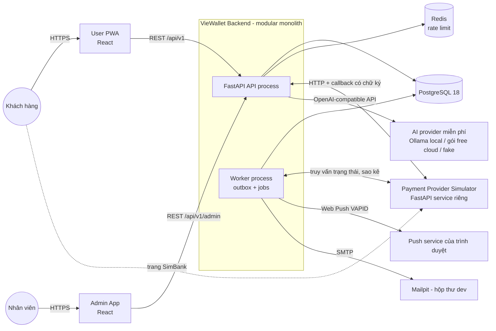
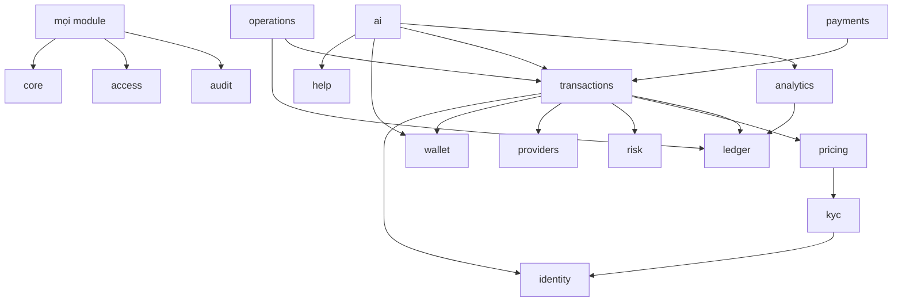

# Tài liệu kiến trúc phần mềm

| Mục | Giá trị |
|---|---|
| Trạng thái | Bản nháp chờ duyệt (Phase 0) |
| Cập nhật | 2026-11-21 |
| Liên quan | [ADR](../adr/README.md), [Database](database.md), [Xử lý tài chính](financial-processing.md), [Bảo mật](security.md) |

## 1. Yếu tố dẫn dắt kiến trúc

1. **Đúng đắn tài chính** trên hết: ledger kế toán kép, DB transaction nguyên tử, idempotency, khóa dòng theo thứ tự.
2. **Truy vết**: mọi thay đổi trạng thái là một bản ghi chỉ-thêm (journal, transaction event, audit log).
3. **Biên thay thế được**: payment provider, AI provider, kênh thông báo và lưu trữ file nằm sau interface.
4. **Quy mô một người phát triển**: một backend triển khai (modular monolith), một database, hạ tầng tối thiểu.
5. **Dễ kiểm thử**: lõi tài chính là domain logic thuần; integration test chạy trên PostgreSQL thật.
6. **Không phát sinh chi phí**: mọi thành phần chạy local, AI dùng model miễn phí.

## 2. Bối cảnh hệ thống



## 3. Container (đơn vị triển khai)

| Container | Công nghệ | Trách nhiệm |
|---|---|---|
| `web` | React 19 + TS + Vite, PWA | App khách hàng. Bundle tĩnh do nginx (prod) hoặc Vite (dev) phục vụ. |
| `admin` | React 19 + TS + Vite | App nhân viên. Bundle và origin riêng; code admin không bao giờ gửi tới khách hàng. |
| `api` | Python 3.14, FastAPI, SQLAlchemy 2 async, psycopg 3 | Toàn bộ HTTP API, logic nghiệp vụ đồng bộ. |
| `worker` | Cùng codebase với `api`, entrypoint khác | Phát outbox, gửi thông báo, truy vấn trạng thái provider, hết hạn, đối soát, job định kỳ. |
| `simulator` | Python, FastAPI, schema DB riêng | Mô phỏng ngân hàng/payment provider, trang checkout, callback, sao kê, điều khiển kịch bản. |
| `postgres` | PostgreSQL 18 | Một instance, schema `app` và `simulator` với DB role riêng. |
| `redis` | Redis 8 (hoặc Valkey) | Chỉ dùng cho bộ đếm rate limit và cache ngắn hạn. Không phải nguồn dữ liệu gốc. |
| `mailpit` | Mailpit | Bắt email gửi đi trong môi trường dev. |
| `ollama` (tùy chọn, profile `ai`) | Ollama | Chạy model AI local miễn phí. Có thể chạy trên host Windows thay vì container để dùng GPU dễ hơn. |

## 4. Kiến trúc backend

### 4.1 Phong cách

Modular monolith, DDD thực dụng, clean architecture *ở chỗ đáng làm*:

- **Lõi tài chính** (`ledger`, `transactions`, `pricing`, phần đánh giá của `risk`): domain layer Python thuần (value object, state machine, quy tắc posting, tính phí), không import framework. Unit test không cần DB.
- **Module hỗ trợ** (`notifications`, `support`, `config`): application service dùng trực tiếp SQLAlchemy model qua repository. Không có lớp domain entity riêng, vì đó chỉ là thủ tục không đem lại giá trị.

### 4.2 Các lớp trong một module

```text
modules/<name>/
  api.py            # FastAPI router: HTTP <-> schema, dependency xác thực, không có logic nghiệp vụ
  schemas.py        # Pydantic request/response (hợp đồng API)
  service.py        # Application service: use case, ranh giới transaction, kiểm tra permission
  domain/           # (module lõi) logic thuần: entity, value object, state machine, policy
  repository.py     # Truy cập dữ liệu (SQLAlchemy), nơi duy nhất có query
  models.py         # Bảng SQLAlchemy ORM do module này sở hữu
  public.py         # Interface công khai cho module khác (hàm/DTO)
  events.py         # Domain event module này phát ra
  handlers.py       # Event handler module này đăng ký (worker chạy)
```

Chiều phụ thuộc: `api → service → domain`, `service → repository → models`. Domain không bao giờ import service/repository/infrastructure.

### 4.3 Quy tắc ranh giới module (`import-linter` kiểm tra trong CI)

1. Một module chỉ được import module khác **qua `public.py`** của module đó.
2. Một module không bao giờ đọc/ghi trực tiếp bảng của module khác. Ngoại lệ: query báo cáo chỉ-đọc trong `analytics`, đọc qua SQL view đã khai báo.
3. Tác dụng phụ xuyên module không cần nguyên tử đi qua **domain event** (outbox). Tác dụng phụ cần nguyên tử (ví dụ chuyển tiền ghi ledger) là lời gọi đồng bộ trực tiếp trong cùng DB transaction (bên gọi sở hữu transaction; bên được gọi nhận session/unit of work).
4. `core` (shared kernel) không phụ thuộc module nào.

### 4.4 Danh sách module

| Module | Sở hữu | Trách nhiệm chính |
|---|---|---|
| `core` (shared kernel) | — | Config, DB session/unit of work, `Money`, ID (UUIDv7), clock, lỗi (Problem Details), phân trang, idempotency store, outbox, rate limiter, logging, tiện ích mật mã. |
| `identity` | users, credentials, sessions, login history, xác minh email, đặt lại mật khẩu, MFA, PIN | Đăng ký, đăng nhập, token, session, mật khẩu, MFA, trạng thái tài khoản, PIN giao dịch. |
| `access` | roles, permissions, role_permissions, user_roles | RBAC, kiểm tra permission, đánh giá scope. |
| `kyc` | kyc_profiles, kyc_submissions, kyc_documents, kyc_reviews | KYC mô phỏng và quy trình duyệt, tier KYC. |
| `wallet` | wallets, bank_destinations, recipients | Vòng đời và trạng thái ví, số ví, tài khoản nhận tiền và người nhận đã lưu. |
| `ledger` | ledger_accounts, journals, postings, account_balances | Engine posting kế toán kép, số dư, bất biến. Module duy nhất thay đổi số dư. |
| `transactions` | transactions, transaction_events | Vòng đời giao dịch nghiệp vụ và điều phối mọi loại: nạp, rút, chuyển, thanh toán, hoàn tiền, đảo, điều chỉnh. Gọi `ledger`, `pricing`, `risk`, `providers`. |
| `payments` | merchants, payment_requests | Hồ sơ merchant, payment request/payload QR, xin tiền giữa người dùng. Tạo giao dịch PAYMENT qua `transactions.public`. |
| `providers` | providers, provider_operations, provider_callbacks | Provider abstraction (port `PaymentProvider`), adapter simulator, hộp nhận callback, truy vấn trạng thái. |
| `pricing` | fee_rules, limit_rules | Tính phí và kiểm tra hạn mức. |
| `risk` | risk_rules, risk_assessments, risk_alerts, account_risk_flags | Rule engine, quyết định, cảnh báo, cờ rủi ro. |
| `operations` | approval_requests, reconciliation_runs, reconciliation_items, recovery_cases | Maker-checker, đối soát, hàng đợi vận hành. |
| `support` | tickets, ticket_messages | Khiếu nại và hỗ trợ. |
| `notifications` | notifications, notification_deliveries, notification_preferences, push_subscriptions, notification_templates | Hộp thư, tùy chọn, gửi theo kênh (in-app, Web Push, email). |
| `analytics` | budgets, savings_goals, transaction_categories, category_overrides, view báo cáo | Tổng hợp tài chính cá nhân, báo cáo admin, xuất CSV. |
| `ai` | ai_conversations, ai_messages, ai_tool_calls, ai_requests, ai_prompts, ai_model_configs | Orchestrator, provider abstraction, tool registry, guardrails, mức sử dụng. |
| `audit` | audit_logs | Audit trail chỉ-thêm, mọi module dùng chung. |
| `config` | system_settings, feature_flags | Cấu hình runtime có phiên bản và maker-checker. |
| `help` | help_articles | Nội dung help center; tìm kiếm full-text (tool AI dùng). |

`deposit`, `withdrawal`, `transfer` trong yêu cầu là **use case bên trong `transactions`**, không phải module riêng. Chúng dùng chung engine state machine, idempotency, tạo journal và event log. Tách ra sẽ nhân đôi phần đó. Mỗi use case có file service riêng (`transactions/use_cases/deposit.py`, ...).

### 4.5 Đồ thị phụ thuộc module (lời gọi đồng bộ)



Bất đồng bộ (event qua outbox): `transactions` → `notifications`, `analytics` (gán danh mục), `risk` (giám sát sau giao dịch), `ai` (cảnh báo/insight); `kyc` → `notifications`, `pricing` (đổi tier); `identity` → `notifications`, `risk`.

### 4.6 Unit of work và transaction

- Một request = một DB transaction, mở ở lớp `service` bằng `async with uow:`. Commit một lần ở cuối.
- Mức cô lập: `READ COMMITTED`, có `SELECT ... FOR UPDATE` tường minh trên dòng số dư theo thứ tự cố định (xem [Xử lý tài chính §6](financial-processing.md#6-kiểm-soát-đồng-thời)).
- Outbox row và audit row được insert trong cùng transaction.
- Lời gọi HTTP ra ngoài (provider, LLM, push) **không bao giờ** thực hiện khi đang giữ khóa dòng. Lời gọi provider diễn ra sau khi đã commit trạng thái "ý định", kết quả được áp dụng trong transaction mới.

### 4.7 Xử lý nền

Dùng PostgreSQL, không thêm message broker (ADR-0006):

- Bảng `outbox_events`: ghi trong transaction nghiệp vụ; worker nhận theo lô bằng `FOR UPDATE SKIP LOCKED`, gọi handler, đánh dấu đã xử lý; retry với backoff lũy thừa; chuyển dead-letter sau N lần (xem được trong admin).
- Bảng `scheduled_jobs`: job định kỳ (quét hết hạn, truy vấn trạng thái, đối soát, kiểm tra ngân sách), chống chạy trùng bằng cách khóa dòng của job (`FOR UPDATE SKIP LOCKED`) và dời `next_run_at` trong cùng transaction, nên nhiều worker chạy cùng lúc vẫn chỉ một worker chạy job trong mỗi chu kỳ.
- Handler phải idempotent (khóa theo event id).

### 4.8 Mối quan tâm xuyên suốt

| Vấn đề | Cách làm |
|---|---|
| Lỗi | Domain exception ánh xạ sang RFC 9457 Problem Details với `code` cố định. Không trả stack trace cho client. |
| Logging | `structlog` JSON; trường: `ts, level, msg, correlation_id, user_id (hash với khách hàng), route, latency_ms`. Processor che PII/bí mật. |
| Correlation | Nhận hoặc sinh `X-Request-ID`; truyền vào event của worker, lời gọi provider và audit row. |
| Metrics | Endpoint Prometheus (`/metrics`, chỉ mạng nội bộ): latency request, số giao dịch theo loại/trạng thái, độ trễ outbox, latency provider, token AI. |
| Config | `pydantic-settings`, biến môi trường, `.env` chỉ cho dev; không commit bí mật. Môi trường: `development`, `simulation`, `test`, `production-like`. |
| Thời gian | Port `Clock` được inject; test đóng băng thời gian. |
| ID | Khóa chính UUIDv7 (sắp theo thời gian, `uuid.uuid7()` của Python 3.14); mã tham chiếu dễ đọc riêng cho giao dịch và ví. |

## 5. Kiến trúc frontend

Monorepo pnpm workspace (ADR-0007):

```text
frontend/
  apps/
    web/        # PWA khách hàng
    admin/      # app nhân viên
  packages/
    ui/         # design system: token, primitive, component, wrapper biểu đồ
    api-client/ # type sinh từ OpenAPI + fetch client có type + helper TanStack Query
    shared/     # định dạng tiền, tiện ích ngày, cấu hình i18n, schema validation
```

Bên trong một app:

```text
src/
  app/          # provider, router, error boundary, query client
  routes/       # module route (trang), lazy-load
  features/     # lát cắt tính năng: auth, wallet, transfer, deposit, ... (component + hook + api)
  components/   # component dùng chung riêng của app
  lib/          # quản lý auth/session, đăng ký service worker
  i18n/         # vi.json, en.json
```

Quy tắc:

- Server state: chỉ dùng TanStack Query. UI state phía client: React state/context; không dùng global store trừ khi có nhu cầu thật.
- Frontend không tính toán tài chính, chỉ định dạng. Tổng tiền, phí, hạn mức và số liệu phân tích lấy từ API. Frontend chỉ được kiểm tra *định dạng* (số nguyên dương, độ dài tối đa) để cải thiện UX.
- Form: React Hook Form + Zod; schema Zod phản chiếu ràng buộc API cho UX, backend vẫn là nơi quyết định.
- Số tiền nhận về dạng chuỗi số nguyên đơn vị nhỏ nhất, định dạng bằng `Intl.NumberFormat('vi-VN', { style: 'currency', currency })` qua helper an toàn với `BigInt`.
- Access token chỉ giữ trong bộ nhớ; làm mới qua cookie httpOnly. Permission từ `/me` quyết định UI hiển thị gì.
- Thư viện đang dùng (Phase 1): React 19, React Router 8, TanStack Query 5, i18next, Radix Dialog, lucide-react, clsx, openapi-fetch + openapi-typescript, Tailwind CSS 4, Vite 8, Vitest 5, Testing Library. TypeScript được ghim ở 6.0 vì typescript-eslint chưa hỗ trợ TypeScript 7 (peer `<6.1.0`); nâng cấp khi typescript-eslint hỗ trợ.
- Thư viện dự kiến thêm ở phase sau, khi có tính năng cần: TanStack Table (admin), Recharts, Motion, React Hook Form + Zod, `vite-plugin-pwa` (injectManifest), `@zxing/browser` để quét QR. Component được viết trực tiếp trên Radix primitive, không dùng CLI shadcn/ui.
- Package nội bộ (`packages/*`) được dùng ở dạng mã nguồn TypeScript (field `exports` trỏ vào `src/`), không có bước build riêng; Vite của từng app biên dịch chúng.

## 6. Cấu trúc repository

```text
VieWallet/
  CLAUDE.md
  README.md
  docs/                    # bộ tài liệu này
  backend/
    pyproject.toml         # quản lý bằng uv
    app/
      main.py              # entrypoint API
      worker.py            # entrypoint worker
      core/
      modules/<module>/
    migrations/            # Alembic
    tests/
      unit/  integration/  api/  concurrency/  property/
  simulator/
    pyproject.toml
    simulator/ ...
    tests/
  frontend/                # pnpm workspace (apps/web, apps/admin, packages/*)
  e2e/                     # Playwright (project riêng, chạy trên compose stack)
  infra/
    docker/                # backend.Dockerfile, frontend.Dockerfile, nginx/, postgres/initdb/
  compose.yaml             # toàn bộ stack local (đặt ở gốc repo để `docker compose up` chạy ngay)
  .github/workflows/ci.yml
```

`simulator/` chưa tồn tại; được tạo ở Phase 4.

## 7. Góc nhìn triển khai

- **Local**, hai cách (chi tiết trong [Hướng dẫn môi trường](../development/setup.md)):
  - *Full stack*: `docker compose up -d --build` chạy postgres, redis, mailpit, migrate (job một lần: Alembic + seed), api, worker, web, admin. Frontend được build tĩnh và phục vụ bằng nginx (cùng origin, `/api` được proxy sang api).
  - *Phát triển hằng ngày*: chỉ chạy `postgres redis mailpit` trong Docker; api/worker chạy trên host bằng `uv run` (có `--reload`), frontend chạy `pnpm dev:web` / `pnpm dev:admin` (Vite proxy `/api` sang `127.0.0.1:8000`). Cách này thay cho bind mount + hot reload trong container, vì theo dõi file qua bind mount trên Windows chậm và không ổn định.
  - Ollama (Phase 11) chạy trên host để dùng GPU RTX.
- **Cổng trên host**: Postgres `55432` (máy dev đã có PostgreSQL native chiếm 5432 và 5433), Redis `6379`, Mailpit `8025`, api `8000`, web `8080`, admin `8081`, Vite dev `5173`/`5174`. Mọi cổng chỉ bind vào `127.0.0.1`.
- **CI**: GitHub Actions — backend (ruff, mypy strict, import-linter, pytest + coverage ≥ 90 % với Postgres/Redis service container, kiểm tra OpenAPI không lệch), frontend (kiểm tra type sinh từ OpenAPI không lệch, prettier, eslint, tsc, vitest, build), e2e (compose stack + Playwright), quét bí mật bằng gitleaks. AI test dùng provider fake.
- **Production-like (Phase 13)**: một VM hoặc nền tảng container; reverse proxy Caddy/nginx có TLS; hostname riêng `app.`, `admin.`, `api.`, `sim.`; hostname admin có thể giới hạn IP. Chọn mục tiêu cụ thể ở Phase 13, ưu tiên phương án miễn phí.

## 8. Kịch bản thuộc tính chất lượng

| Thuộc tính | Kịch bản | Cơ chế |
|---|---|---|
| Đúng đắn | Hai lệnh chuyển tranh nhau cùng một ví, tổng vượt số dư | `FOR UPDATE` có thứ tự trên dòng số dư; lệnh thứ hai thấy số dư mới và thất bại; DB CHECK là chốt chặn cuối. |
| Idempotency | Client gửi lại confirm sau khi rớt mạng | Bản ghi idempotency trả lại response đã lưu; không có journal thứ hai. |
| Khả năng phục hồi | Provider timeout khi chi tiền | Thao tác đánh dấu UNKNOWN; job truy vấn trạng thái giải quyết; tiền vẫn bị giữ; không gửi lại nếu không có key chống trùng phía provider. |
| Bảo mật | Access token bị đánh cắp | Sống 10 phút; kiểm tra thu hồi session mỗi request; thao tác tiền cần PIN. |
| Riêng tư | AI bị hỏi về giao dịch của người khác | Tool lấy user id từ ngữ cảnh xác thực; không có tham số chọn user khác. |
| Bảo trì | Thay simulator bằng provider thật | Viết adapter `PaymentProvider` mới; logic nghiệp vụ không đổi. |
| Chi phí | Chạy demo AI không có tiền | Ollama local hoặc provider fake; không có khóa API trả phí nào trong hệ thống. |
