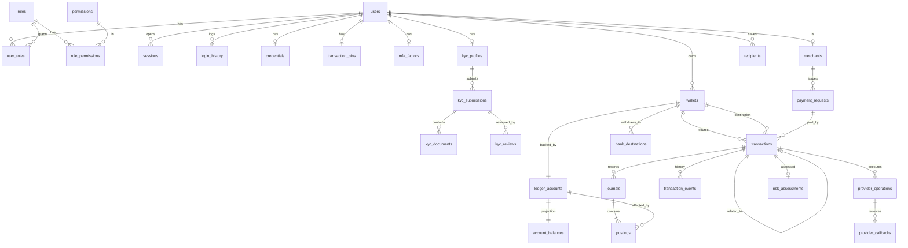
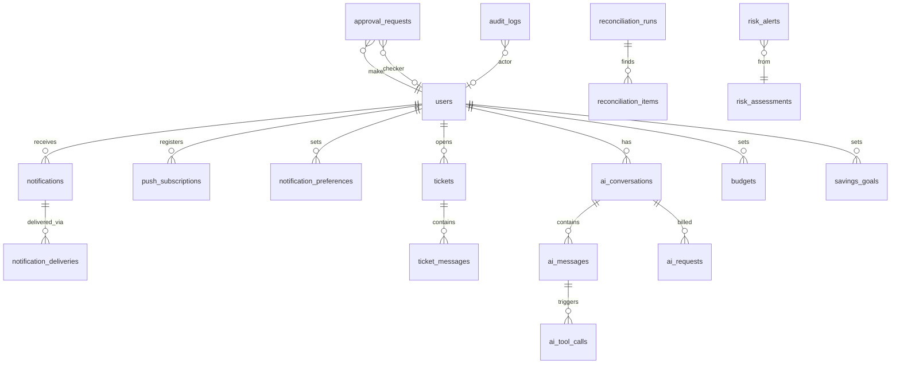

# Thiết kế database — ERD và từ điển dữ liệu

| Mục | Giá trị |
|---|---|
| Trạng thái | Bảng được tạo ở phase cần đến nó, luôn qua migration Alembic. Đã cài đặt: `0001` (nền tảng), `0002` (identity, access, audit), `0003` (ví, ledger, giao dịch, pricing, risk, phê duyệt, đối soát), `0004` (provider, tài khoản nhận, thông báo in-app, hồ sơ thu hồi, `users.kyc_tier`) |
| Cập nhật | 2026-11-23 |
| Engine | PostgreSQL 18, schema `app` (simulator dùng schema `simulator` với role riêng) |
| Liên quan | [Xử lý tài chính](financial-processing.md), [Kiến trúc](architecture.md) |

## 1. Quy ước

- Tên bảng: số nhiều, `snake_case`. Khóa chính `id UUID` (UUIDv7, ứng dụng sinh). Khóa ngoại `<entity>_id`.
- Timestamp `TIMESTAMPTZ` theo UTC: `created_at` (mặc định `now()`), `updated_at` (ứng dụng cập nhật) với bảng có thể sửa.
- Tiền: `<tên>_minor BIGINT` + `currency CHAR(3)` khóa ngoại tới `currencies.code`.
- Enum: `TEXT` + `CHECK (col IN (...))` (dễ migrate hơn PG enum). Enum domain nằm trong Python và là nguồn duy nhất.
- Phiên bản lạc quan: `version INT NOT NULL DEFAULT 1` trên aggregate có thể sửa (transactions, wallets, approval_requests, configs).
- Xóa mềm: không dùng cho dữ liệu tài chính. User bị đóng, không bị xóa. Xóa PII (nếu cần) = ẩn danh hóa.
- **Bảng chỉ-thêm** (`journals`, `postings`, `transaction_events`, `audit_logs`, `risk_assessments`, `provider_callbacks`, `login_history`): trigger `BEFORE UPDATE OR DELETE` ném lỗi; DB role của ứng dụng cũng không có quyền `UPDATE/DELETE` trên các bảng này.
- Hai DB role: `viewallet_migrator` (DDL, chủ sở hữu) và `viewallet_app` (chỉ DML, quyền hạn chế).
- JSONB chỉ cho dữ liệu thực sự biến đổi (metadata, payload provider, tham số rule), không dùng cho cột hay lọc.

## 2. ERD (lõi)

## 3. Từ điển dữ liệu

Chỉ liệt kê cột chính; bỏ qua `id`, `created_at`, `updated_at`, `version` trừ khi đáng chú ý.

### 3.1 Định danh và truy cập

**users** — `email CITEXT UNIQUE NOT NULL`, `email_verified_at`, `phone TEXT UNIQUE NULL` (E.164, giả lập), `full_name`, `display_name`, `user_type` (CUSTOMER, MERCHANT, STAFF), `status` (ACTIVE, LOCKED, RESTRICTED, SUSPENDED, CLOSED), `locked_until`, `kyc_tier SMALLINT DEFAULT 0`, `locale` (vi, en), `last_login_at`.
Index: `status`, `created_at`. Nhân viên và khách hàng dùng chung bảng; `user_type=STAFF` không được sở hữu ví khách hàng.

**credentials** — `user_id PK/FK`, `password_hash` (chuỗi mã hóa Argon2id), `password_changed_at`, `failed_attempts INT`, `last_failed_at`.

**mfa_factors** — `user_id`, `type` (TOTP), `secret_encrypted BYTEA` (AES-GCM bằng khóa ứng dụng), `confirmed_at`, `last_used_step BIGINT` (chống phát lại). `UNIQUE(user_id, type)`.

**sessions** (đã cài đặt, migration `0002`) — `user_id`, `audience` (WEB, ADMIN), `state` (ACTIVE, MFA_PENDING), `token_hash` (SHA-256, UNIQUE), `created_at`, `last_seen_at`, `idle_expires_at`, `absolute_expires_at`, `revoked_at`, `revoke_reason`, `mfa_verified_at`, `mfa_failed_attempts`, `ip`, `user_agent`. Index `(user_id, revoked_at)`.

**login_history** (chỉ-thêm) — `user_id NULL` (lần thử với email không tồn tại lưu email đã hash), `email_hash`, `audience`, `result` (SUCCESS, BAD_CREDENTIALS, LOCKED, MFA_REQUIRED, MFA_FAILED), `ip`, `user_agent`, `at`.

**verification_tokens** (đã cài đặt) — `user_id`, `purpose` (VERIFY_EMAIL, RESET_PASSWORD, RESET_PIN, CHANGE_EMAIL), `secret_hash` (HMAC cho mã 6 số, SHA-256 cho link; UNIQUE), `target_email` (đổi email), `attempts`, `created_at`, `expires_at`, `consumed_at`.

**mfa_recovery_codes** (đã cài đặt) — `user_id`, `code_hash` (UNIQUE), `used_at`.

**transaction_pins** — `user_id PK`, `pin_hash` (Argon2id trên HMAC-SHA256(pepper, pin)), `failed_attempts`, `locked_until`, `lock_count`, `changed_at`, `reset_at`.

**roles** — `code UNIQUE` (CUSTOMER, MERCHANT, SUPPORT, OPERATIONS, FINANCE, RISK_ANALYST, KYC_REVIEWER, ADMIN, SUPER_ADMIN), `name`, `is_system BOOL`, `is_staff BOOL`.
**permissions** — `code UNIQUE` (`resource:action:scope`, ví dụ `transaction:read:any`), `description`, `is_sensitive BOOL` (cần phiên vừa xác thực MFA).
**role_permissions** — `(role_id, permission_id) PK`.
**user_roles** — `(user_id, role_id) PK`, `granted_by`, `granted_at`, `expires_at NULL`.

### 3.2 KYC

**kyc_profiles** — `user_id UNIQUE`, `status` (NOT_STARTED, PENDING, IN_REVIEW, APPROVED, REJECTED, EXPIRED), `tier`, `approved_at`, `expires_at`, `current_submission_id`.
**kyc_submissions** — `kyc_profile_id`, `full_name`, `date_of_birth`, `document_type` (NATIONAL_ID, PASSPORT, DRIVER_LICENSE), `document_number_masked`, `document_number_hash`, `address`, `status`, `submitted_at`, `claimed_by`, `claimed_at`. Index `(status, submitted_at)` cho hàng đợi.
**kyc_documents** — `submission_id`, `kind` (FRONT, BACK, SELFIE), `storage_key`, `content_type`, `size_bytes`, `sha256`.
**kyc_reviews** — `submission_id`, `reviewer_id`, `decision` (APPROVE, REJECT), `reason_code`, `note`, `at`.

### 3.3 Ví và ledger

> Đã cài đặt ở migration `0003` (Phase 3). Khác bản thiết kế: `wallets` có thêm `freeze_source` (SELF, STAFF, SYSTEM; CHECK chỉ có giá trị khi `status = FROZEN`) để khách chỉ tự mở được khóa do chính mình đặt; cột chiều của posting tên là `side`. Trigger ràng buộc trễ `journals_balanced` và `postings_balanced` (hàm `app.check_journal_balanced()`, SQLSTATE `VW002`) từ chối lúc commit mọi journal không cân, ít hơn 2 dòng hoặc lệch tiền tệ. Role ứng dụng: `ledger_accounts` chỉ SELECT/INSERT; `account_balances` không DELETE; `journals`, `postings` chỉ-thêm.

**currencies** — `code CHAR(3) PK`, `exponent SMALLINT`, `enabled BOOL`.

**wallets** — `owner_user_id`, `wallet_number CHAR(10) UNIQUE`, `wallet_type` (MAIN, MERCHANT), `currency`, `status` (ACTIVE, FROZEN, SUSPENDED, CLOSED), `status_reason`, `frozen_by`, `frozen_at`, `ledger_account_id UNIQUE`. `UNIQUE(owner_user_id, currency, wallet_type)`.

**ledger_accounts** — `code` (CUSTOMER_WALLET, HOLD, PROVIDER_SETTLEMENT, FEE_REVENUE, ADJUSTMENT_EXPENSE, SUSPENSE), `type` (ASSET, LIABILITY, INCOME, EXPENSE), `normal_side` (DEBIT, CREDIT), `currency`, `owner_ref` (id ví / mã provider / NULL), `allow_negative BOOL`, `name`. `UNIQUE NULLS NOT DISTINCT (code, currency, owner_ref)`.

**account_balances** — `account_id PK/FK`, `currency`, `balance_minor BIGINT NOT NULL DEFAULT 0`, `allow_negative BOOL` (sao chép, không đổi), `last_journal_id`, `updated_at`. `CHECK (allow_negative OR balance_minor >= 0)`.

**journals** (chỉ-thêm) — `transaction_id NULL FK`, `kind` (DEPOSIT_SETTLE, WITHDRAWAL_HOLD, …), `currency`, `description`, `reverses_journal_id NULL UNIQUE`, `posted_at`, `correlation_id`, `created_by` (user hoặc hệ thống).

**postings** (chỉ-thêm) — `journal_id`, `account_id`, `direction` (DEBIT, CREDIT), `amount_minor BIGINT CHECK (> 0)`, `currency`, `seq SMALLINT`. Index: `(account_id, journal_id)`, `journal_id`. Deferred constraint trigger: Σ nợ = Σ có cho mỗi journal; mọi posting cùng tiền tệ với journal.

### 3.4 Giao dịch

> `transactions` và `transaction_events` đã cài đặt ở `0003`. Khác bản thiết kế: thêm `held_minor` (số tiền giao dịch đang giữ trên tài khoản HOLD; bất biến I5 so sánh Σ `held_minor` với số dư HOLD); cột `metadata` (thuộc tính Python `extra`) lưu dữ liệu nội bộ như ghi chú của nhân viên; `payment_request_id`, `bank_destination_id`, `provider_code` sẽ thêm ở Phase 4–5 khi có bảng đích; index trigram để tìm kiếm thêm ở Phase 7. CHECK `wallets_match_type` buộc đúng ví theo loại (ví dụ ADJUSTMENT có đúng một trong hai ví). Phân trang lịch sử dùng `(wallet_id, id)` vì UUIDv7 đã tăng theo thời gian.

**transactions** — `reference TEXT UNIQUE`, `type`, `status`, `amount_minor BIGINT CHECK (> 0)`, `fee_minor BIGINT DEFAULT 0 CHECK (>= 0)`, `currency`, `initiator_user_id`, `source_wallet_id NULL`, `destination_wallet_id NULL`, `counterparty_snapshot JSONB` (tên/số ví đã che tại thời điểm giao dịch), `description TEXT` (≤ 140 ký tự, đã làm sạch), `category_code`, `idempotency_key`, `related_transaction_id NULL` (bản gốc của hoàn tiền/đảo), `payment_request_id NULL`, `bank_destination_id NULL`, `provider_code NULL`, `fee_rule_id`, `fee_rule_version`, `quote_expires_at`, `risk_decision`, `failure_code`, `failure_message`, `refunded_amount_minor BIGINT DEFAULT 0`, `metadata JSONB`, `confirmed_at`, `completed_at`, `version`.
Constraint: `UNIQUE(initiator_user_id, idempotency_key)`, `CHECK (refunded_amount_minor <= amount_minor)`, CHECK theo loại (ví dụ TRANSFER cần cả hai ví và `source <> destination`).
Index: `(source_wallet_id, created_at DESC, id)`, `(destination_wallet_id, created_at DESC, id)`, `(status, type, created_at)` cho hàng đợi vận hành, `(source_wallet_id, type, created_at)` cho hạn mức, `related_transaction_id`, index trigram trên `reference` và `description` (pg_trgm) để tìm kiếm.

**transaction_events** (chỉ-thêm) — `transaction_id`, `from_status NULL`, `to_status`, `reason_code`, `message`, `actor_type` (USER, STAFF, SYSTEM, PROVIDER), `actor_id`, `correlation_id`, `at`. Index `(transaction_id, at)`.

**idempotency_keys** (đã cài đặt, migration `0001`) — `principal_id`, `scope` (id endpoint), `key`, `request_hash`, `status` (IN_PROGRESS, COMPLETED), `response_status`, `response_body JSONB`, `resource_id`, `locked_until` (claim đang xử lý; quá hạn thì request khác được tiếp quản), `created_at`, `updated_at`, `expires_at`. `UNIQUE(principal_id, scope, key)`, index `expires_at`; job `purge_expired_idempotency_keys` chạy mỗi giờ.

**outbox_events** (đã cài đặt) — `topic`, `aggregate_type`, `aggregate_id`, `payload JSONB`, `status` (PENDING, PROCESSING, DONE, DEAD), `attempts`, `next_attempt_at`, `locked_until` (lease của worker), `last_error`, `correlation_id`, `created_at`, `processed_at`. Partial index `ix_outbox_events_due (next_attempt_at) WHERE status IN ('PENDING','PROCESSING')`.

**scheduled_jobs** (đã cài đặt) — `name PK`, `next_run_at`, `last_started_at`, `last_finished_at`, `last_status` (RUNNING, SUCCEEDED, FAILED), `last_error`.

**currencies** (đã cài đặt) — role app chỉ có quyền SELECT; dữ liệu do seed (role migrator) quản lý.

### 3.5 Thanh toán và tài khoản nhận

> `bank_destinations` đã cài đặt ở `0004`: thêm `account_fingerprint` (HMAC có khóa) để phát hiện trùng mà không giải mã; số tài khoản mã hóa AES-256-GCM với associated data gắn id dòng; xóa mềm (`status = REMOVED`). `transactions` thêm `provider_code`, `bank_destination_id`.

**merchants** — `user_id UNIQUE`, `wallet_id`, `legal_name` (hư cấu), `display_name`, `mcc` (mã danh mục merchant), `status`, `logo_key`.
**payment_requests** — `code TEXT UNIQUE` (id ngắn trong QR), `issuer_type` (MERCHANT, USER), `issuer_user_id`, `destination_wallet_id`, `amount_minor NULL` (NULL = người trả tự nhập), `currency`, `description`, `single_use BOOL`, `status` (OPEN, PAID, EXPIRED, CANCELLED, DECLINED), `payer_user_id NULL` (cho xin tiền giữa người dùng), `expires_at`, `paid_transaction_id NULL`, `signature` (HMAC của payload).
**bank_destinations** — `user_id`, `bank_code` (danh sách ngân hàng giả lập), `account_number_masked`, `account_number_encrypted`, `account_name`, `verified_at`, `status`. Tối đa 5 mỗi user.
**recipients** — `owner_user_id`, `wallet_id`, `nickname`, `last_used_at`. `UNIQUE(owner_user_id, wallet_id)`.

### 3.6 Provider

> Đã cài đặt ở `0004`. `provider_operations` có thêm `amount_minor`, `currency` (đối chiếu số tiền callback), `inquiry_count`, `recovery_flagged`; khóa duy nhất `(transaction_id, operation)`; trạng thái có thêm `CREATED`, `RETURNED`. `provider_callbacks` lưu cả callback sai chữ ký (`signature_valid = false`, không có body đã parse) và chỉ khử trùng callback hợp lệ (index duy nhất có điều kiện). `provider_callbacks`, `provider_callback_results` chỉ-thêm; `providers` chỉ đọc với role ứng dụng.

**providers** — `code PK` (SIMULATOR), `name`, `status` (ENABLED, DISABLED), `capabilities` (CHARGE, PAYOUT, REFUND), `config JSONB` (không chứa bí mật).
**provider_operations** — `transaction_id`, `provider_code`, `operation` (CHARGE, PAYOUT), `attempt`, `status` (CREATED, SUBMITTED, ACCEPTED, SUCCEEDED, FAILED, UNKNOWN, EXPIRED), `provider_reference UNIQUE NULL`, `request_payload JSONB` (đã che), `response_payload JSONB`, `error_code`, `submitted_at`, `resolved_at`, `next_inquiry_at`. Index `(status, next_inquiry_at)`.
**provider_callbacks** (chỉ-thêm) — `provider_code`, `event_id`, `provider_reference`, `signature_valid BOOL`, `headers JSONB` (đã che), `body JSONB`, `received_at`. `UNIQUE(provider_code, event_id)`. Kết quả xử lý (RECEIVED, APPLIED, IGNORED_DUPLICATE, IGNORED_STALE, REJECTED, ORPHAN) nằm ở bảng đi kèm `provider_callback_results` để hộp nhận giữ được tính chỉ-thêm.

### 3.7 Pricing, rủi ro, vận hành

> Đã cài đặt ở `0003`: `fee_rules`, `limit_rules` (có thêm cột `code` duy nhất để seed idempotent; role ứng dụng chỉ đọc), `risk_assessments` (chỉ-thêm), `approval_requests` (CHECK `maker_is_not_checker`, index duy nhất một trường hợp PENDING cho mỗi đối tượng), `reconciliation_runs`, `reconciliation_items`. Rule rủi ro ở Phase 3 nằm trong code (`risk/domain.py`, có `rules_version`); bảng `risk_rules`, `risk_alerts`, `account_risk_flags`, `recovery_cases` thêm ở Phase 4–6.

**fee_rules** — `txn_type`, `currency`, `scope` (DEFAULT, KYC_TIER, USER), `scope_value`, `fixed_minor`, `bps`, `min_fee_minor`, `max_fee_minor`, `effective_from`, `effective_to`, `version`, `status` (DRAFT, ACTIVE, RETIRED), `approval_request_id`.
**limit_rules** — `txn_type|ALL`, `direction` (OUT, IN), `scope`, `scope_value`, `period` (PER_TXN, DAILY, MONTHLY, BALANCE_CAP), `max_amount_minor`, `max_count`, `min_amount_minor`, `currency`, `status`, `version`.
**risk_rules** — `code UNIQUE`, `description`, `params JSONB`, `score INT`, `action_hint` (SCORE, REVIEW, BLOCK), `enabled`, `version`.
**risk_assessments** (chỉ-thêm) — `transaction_id`, `user_id`, `score`, `decision`, `matched_rules JSONB` (mã, điểm, bằng chứng), `rules_version`, `at`.
**risk_alerts** — `assessment_id NULL`, `user_id`, `transaction_id NULL`, `type`, `severity`, `status` (OPEN, ACKNOWLEDGED, RESOLVED, FALSE_POSITIVE), `assigned_to`, `resolution_note`.
**account_risk_flags** — `user_id`, `flag` (WATCHLIST, CHARGEBACK_HISTORY, ...), `set_by`, `reason`, `expires_at`.
**approval_requests** — `action_type` (ADJUSTMENT, REFUND_HIGH_VALUE, REVERSAL, WALLET_UNFREEZE, CONFIG_CHANGE, ROLE_GRANT, BROADCAST, ...), `target_type`, `target_id`, `payload JSONB` (chính xác thao tác sẽ thực hiện), `payload_hash`, `maker_id`, `maker_reason`, `status` (PENDING, APPROVED, REJECTED, EXECUTED, FAILED, EXPIRED, CANCELLED), `checker_id`, `checker_note`, `decided_at`, `executed_at`, `expires_at`. `CHECK (checker_id IS NULL OR checker_id <> maker_id)`.
**reconciliation_runs** — `kind` (INTERNAL, PROVIDER), `provider_code`, `business_date`, `status`, `stats JSONB`, `started_at`, `finished_at`.
**reconciliation_items** — `run_id`, `type` (MISSING_INTERNAL, MISSING_PROVIDER, AMOUNT_MISMATCH, STATUS_MISMATCH, INVARIANT_VIOLATION), `provider_reference`, `transaction_id NULL`, `expected JSONB`, `actual JSONB`, `status`, `assigned_to`, `resolution`, `resolution_transaction_id`.
**recovery_cases** — `transaction_id`, `reason`, `status`, `assigned_to`, `notes`.

### 3.8 Thông báo, hỗ trợ, analytics, AI, audit, cấu hình

> `notifications` đã cài đặt ở `0004` (khóa duy nhất `(source_event_id, user_id)` thay cho `source_event_id` đơn lẻ vì một sự kiện có thể gửi cho hai người). `notification_deliveries`, `push_subscriptions`, `notification_preferences` làm ở Phase 9. `recovery_cases` (§3.7) đã cài đặt, khóa duy nhất `(transaction_id, reason)`.

**notifications** — `user_id`, `category` (TRANSACTION, SECURITY, KYC, FINANCIAL_ALERT, AI_INSIGHT, SYSTEM, PROMOTION), `type` (khóa template), `title`, `body`, `data JSONB` (deep link, id — không chứa bí mật), `priority`, `read_at`, `source_event_id UNIQUE` (khử trùng). Index `(user_id, read_at, created_at DESC)`.
**notification_deliveries** — `notification_id`, `channel` (IN_APP, PUSH, EMAIL), `target_id` (id đăng ký push / email), `status` (PENDING, SENT, FAILED, SKIPPED), `attempts`, `last_error`, `sent_at`.
**push_subscriptions** — `user_id`, `endpoint TEXT UNIQUE`, `p256dh`, `auth`, `user_agent`, `device_label`, `created_at`, `last_success_at`, `revoked_at`.
**notification_preferences** — `(user_id, category, channel) PK`, `enabled`; cài đặt mức user `push_show_amounts BOOL` nằm ở bảng cài đặt user.
**tickets** / **ticket_messages** — tiêu đề, danh mục, trạng thái (OPEN, IN_PROGRESS, WAITING_CUSTOMER, RESOLVED, CLOSED), `transaction_id NULL`, `assigned_to`; tin nhắn có `author_type`, `is_internal`.
**transaction_categories** — `code PK`, `name_vi`, `name_en`, `icon`, `kind` (EXPENSE, INCOME, TRANSFER). **category_overrides** — `(user_id, transaction_id) PK`, `category_code`.
**budgets** — `user_id`, `category_code|NULL (tổng)`, `month DATE`, `amount_minor`, `alert_thresholds INT[]` (ví dụ {80,100}), `UNIQUE(user_id, category_code, month)`.
**savings_goals** — `user_id`, `name`, `target_minor`, `target_date`, `saved_minor` (tiến độ user tự khai, không di chuyển tiền), `status`.
**ai_conversations** — `user_id`, `audience` (CUSTOMER, STAFF), `title`, `prompt_version`, `model_config_id`, `archived_at`.
**ai_messages** — `conversation_id`, `role` (USER, ASSISTANT), `content JSONB` (các block, gồm tham chiếu data card), `status`, `at`.
**ai_tool_calls** — `message_id`, `tool_name`, `input JSONB`, `output_summary JSONB` (đã che/cắt ngắn), `status` (OK, DENIED, INVALID_INPUT, ERROR), `latency_ms`.
**ai_requests** — `conversation_id`, `provider`, `model`, `prompt_tokens`, `completion_tokens`, `latency_ms`, `finish_reason`, `error_code`. (Không có cột chi phí vì chỉ dùng model miễn phí; token vẫn được theo dõi để quản lý quota và hiệu năng.)
**ai_prompts** — `key`, `version`, `content`, `status` (DRAFT, ACTIVE, RETIRED), `UNIQUE(key, version)`. **ai_model_configs** — `provider`, `base_url`, `model`, `temperature`, `max_tokens`, `context_window`, `supports_tools BOOL`, `enabled`, `is_default`, quota.
**audit_logs** (chỉ-thêm) — `actor_id NULL`, `actor_type`, `actor_roles TEXT[]`, `action` (ví dụ `wallet.freeze`), `target_type`, `target_id`, `before JSONB`, `after JSONB` (trường nhạy cảm đã che), `reason`, `result` (SUCCESS, DENIED, FAILED), `ip`, `user_agent`, `correlation_id`, `approval_request_id`, `at`, `prev_hash`, `hash` (chuỗi SHA-256 để phát hiện giả mạo). Index: `(target_type, target_id, at)`, `(actor_id, at)`, `(action, at)`.
**system_settings** — `key PK`, `value JSONB`, `version`, `updated_by`, `approval_request_id`. **feature_flags** — `key`, `enabled`, `rules JSONB`.
**help_articles** — `slug UNIQUE`, `locale`, `title`, `body_md`, `tags`, `search_vector TSVECTOR` (index GIN).

## 4. Tóm tắt cơ chế toàn vẹn

| Quy tắc | Nơi thực thi |
|---|---|
| Journal cân bằng | Domain (posting builder) + deferred constraint trigger |
| Số dư khách không âm | Domain kiểm tra khi giữ khóa + `CHECK` trên `account_balances` |
| Ledger bất biến | Trigger + không có quyền UPDATE/DELETE |
| Một ví cho mỗi user/tiền tệ/loại | `UNIQUE` |
| Một giao dịch cho mỗi idempotency key | `UNIQUE(initiator_user_id, idempotency_key)` |
| Callback xử lý một lần | `UNIQUE(provider_code, event_id)` + CAS trạng thái giao dịch |
| Tổng hoàn ≤ gốc | Khóa dòng + `CHECK (refunded_amount_minor <= amount_minor)` |
| Maker ≠ checker | Quy tắc service + `CHECK` |
| Chỉ đảo một lần | `UNIQUE(reverses_journal_id)` + state machine |
| Phát hiện giả mạo audit | Hash chain + trigger chỉ-thêm |

## 5. Chiến lược migration và seed

- Alembic, mỗi migration một thay đổi logic, review như code; CI chạy `alembic upgrade head` trên DB trống và test vòng `downgrade -1/upgrade` cho từng migration.
- Trigger/function định nghĩa trong migration (SQL), có integration test.
- Seed (script idempotent, không nằm trong migration): currencies, roles, permissions, tài khoản ledger hệ thống, fee/limit/risk rule mặc định, bài help center, danh mục giao dịch. Seed demo (lệnh riêng, chỉ dev/simulation): user, merchant hư cấu và lịch sử giao dịch sinh ra **qua service**, nên dữ liệu demo tuân theo đúng quy tắc ledger.
