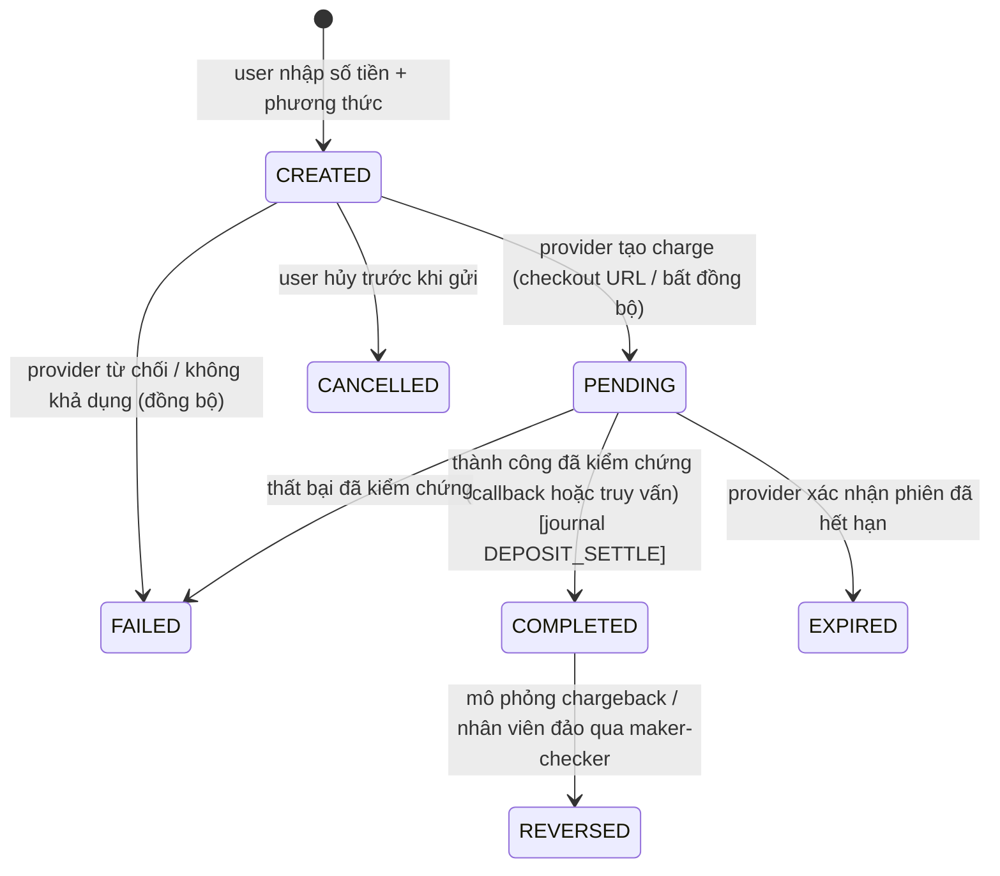
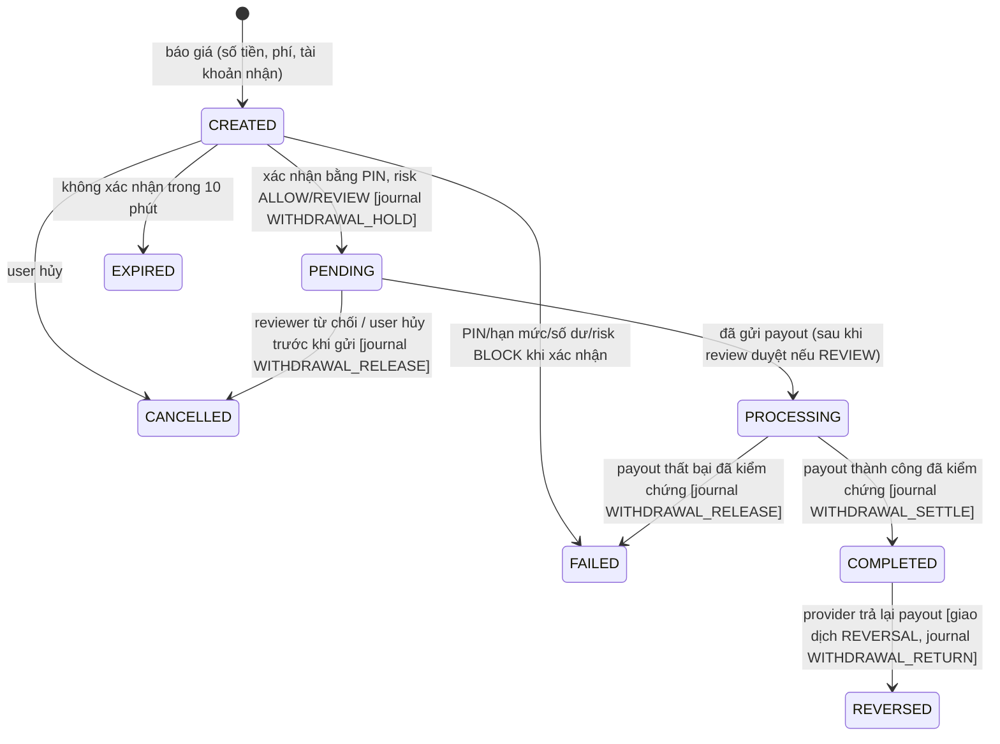
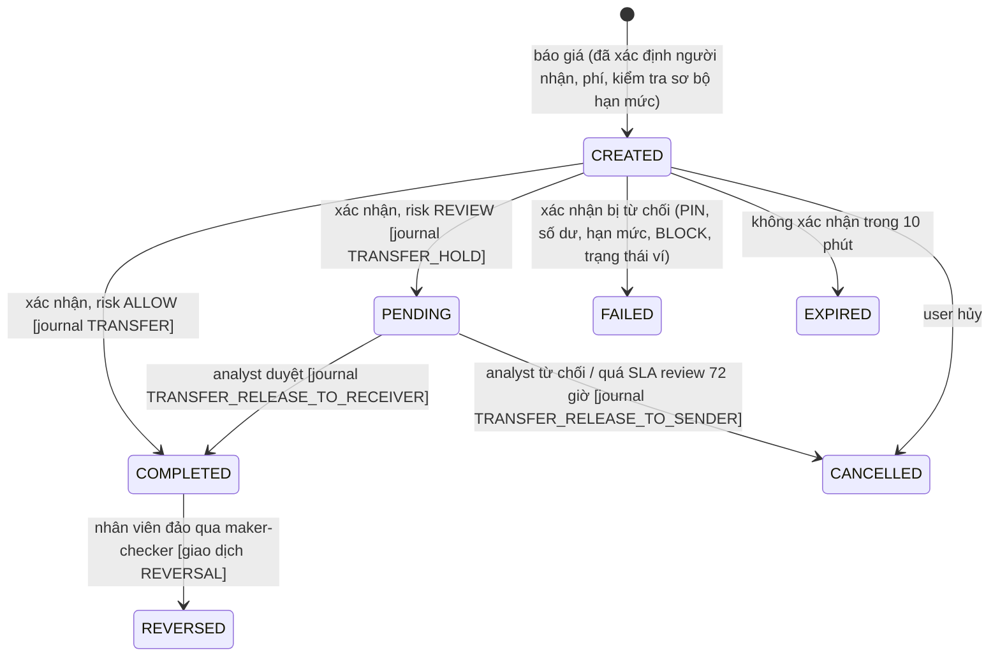
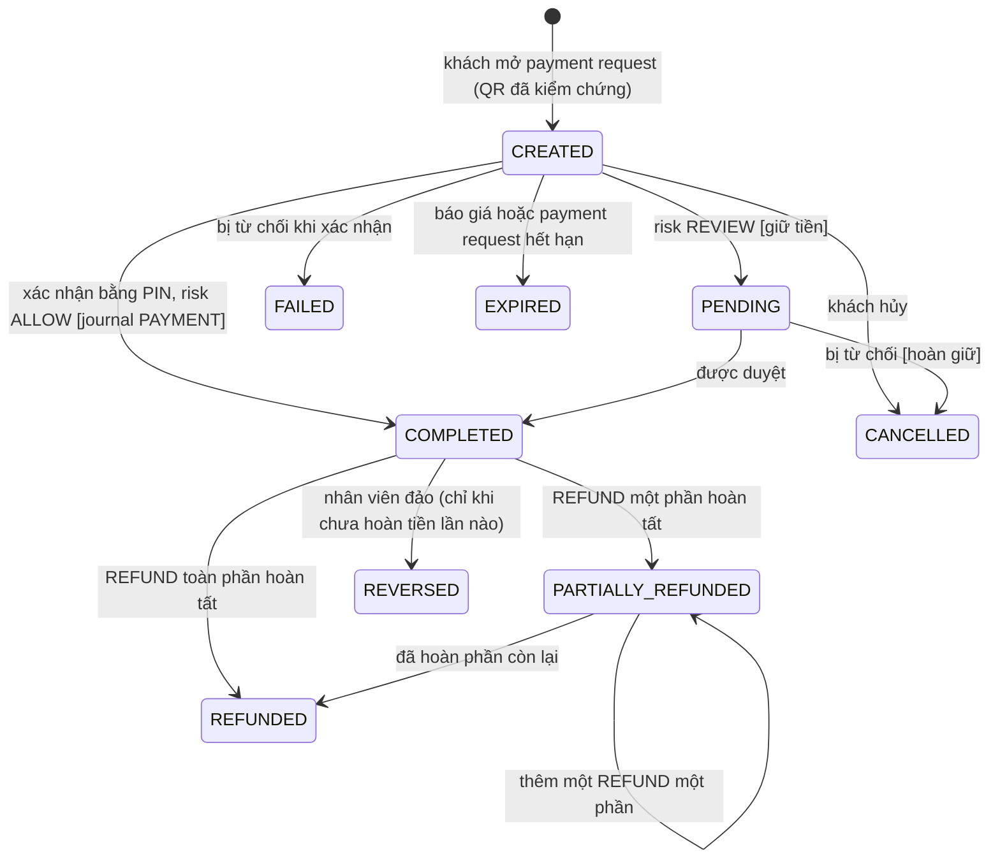
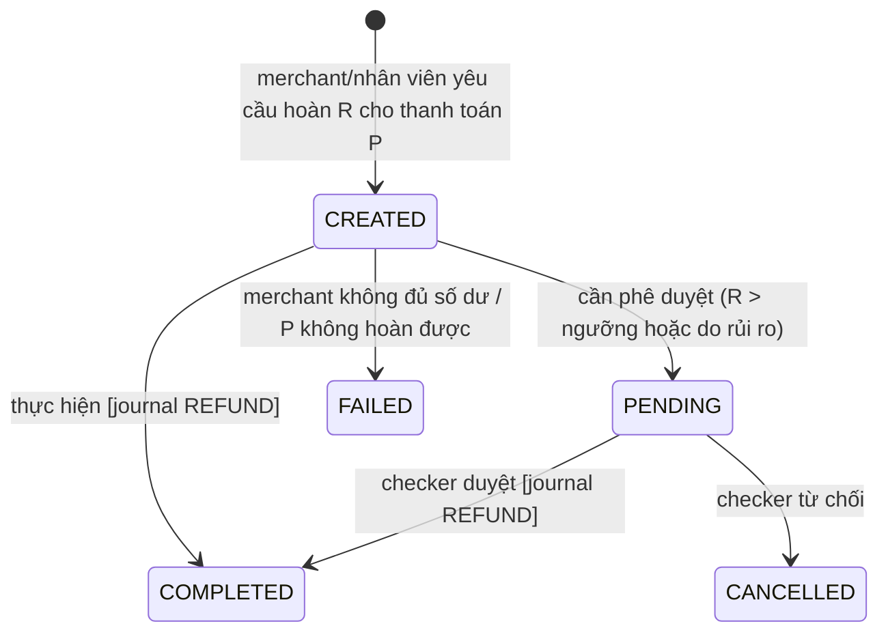

# Thiết kế xử lý tài chính và vòng đời giao dịch

| Mục | Giá trị |
|---|---|
| Trạng thái | Lõi đã cài đặt ở Phase 3 (xem §13) — **tài liệu ưu tiên cao nhất** |
| Cập nhật | 2026-11-23 |
| Liên quan | [Database](database.md), [Payment Provider Simulator](payment-provider-simulator.md), [ADR-0002 Ledger](../adr/0002-double-entry-ledger.md), [ADR-0003 Tiền](../adr/0003-money-representation.md), [ADR-0004 Concurrency](../adr/0004-concurrency-control.md) |

## 1. Nguyên tắc

1. **Ledger là nguồn dữ liệu gốc.** Số dư ví là số dư của tài khoản ledger tương ứng. Không có gì khác được thay đổi tiền.
2. **Kế toán kép.** Mỗi lần di chuyển tiền là một *journal* có ≥ 2 *posting*; tổng ghi nợ = tổng ghi có theo từng tiền tệ.
3. **Bất biến.** Journal và posting không bao giờ bị sửa hay xóa. Sửa sai bằng journal mới (đảo, hoàn tiền, điều chỉnh) có liên kết tới bản gốc.
4. **Hai lớp.** *Giao dịch nghiệp vụ* (bảng `transactions`) mô tả ý định, các bên, trạng thái và vòng đời. *Journal* ghi hiệu ứng kế toán. Một giao dịch có thể có 0..n journal trong đời (ví dụ rút tiền: journal giữ tiền, sau đó journal tất toán hoặc hoàn giữ).
5. **Nguyên tử.** Journal, cập nhật balance projection, đổi trạng thái giao dịch, transaction event, outbox event và audit row cùng commit trong một DB transaction.
6. **Tiền là số nguyên.** Số tiền là `BIGINT` đơn vị nhỏ nhất. Không có float ở bất kỳ đâu trên đường đi của tiền.
7. **Backend quyết định.** Phí, hạn mức, tổng tiền và quyết định rủi ro được backend tính lúc báo giá và kiểm tra lại lúc xác nhận.

## 2. Mô hình tiền

- Value object `Money(amount_minor: int, currency: CurrencyCode)`; chỉ tính toán giữa cùng tiền tệ; khác tiền tệ thì báo lỗi.
- Bảng `currencies`: `code` (ISO 4217), `exponent` (VND = 0, USD = 2), `enabled`. Chỉ bật VND.
- VND có exponent 0, nên `amount_minor` = đồng. 1.000.000 ₫ lưu là `1000000`.
- **Phí phần trăm** dùng basis point (1 bps = 0,01 %). `fee = round_half_up(amount_minor * bps / 10_000)` bằng số học nguyên: `(amount_minor * bps + 5_000) // 10_000`. Sau đó kẹp trong `[min_fee, max_fee]`.
- Truyền qua API: số tiền là **chuỗi** JSON của số nguyên đơn vị nhỏ nhất kèm `currency` (`{"amount": "1500000", "currency": "VND"}`). Tránh client tự ép sang float.
- Kiểm tra: số tiền > 0, ≤ `9_000_000_000_000` (trần an toàn dưới giới hạn BIGINT), là bội của đơn vị nhỏ nhất của tiền tệ (VND: 1; quy tắc sản phẩm: nạp/rút là bội của 1.000 ₫).

## 3. Hệ thống tài khoản (chart of accounts)

Tài khoản được tạo theo từng tiền tệ. Phía số dư thông thường (normal balance) quyết định dấu của số dư lưu trữ (số dư lưu luôn "dương theo phía thông thường").

| Mã | Loại | Phía thường | Chủ sở hữu | Mục đích | Cho phép âm |
|---|---|---|---|---|---|
| `CUSTOMER_WALLET` | Nợ phải trả (liability) | Có | Mỗi ví (khách hàng hoặc merchant) | Số tiền nền tảng đang nợ chủ ví | **Không** (DB CHECK) |
| `HOLD` | Nợ phải trả | Có | Hệ thống (một cho mỗi tiền tệ) | Tiền giữ cho rút tiền đang chờ và chuyển/thanh toán đang review rủi ro | Không |
| `PROVIDER_SETTLEMENT` | Tài sản (asset) | Nợ | Mỗi provider mỗi tiền tệ | Tiền nằm ở provider/ngân hàng (giả lập) | Có (đối soát sẽ gắn cờ) |
| `FEE_REVENUE` | Doanh thu | Có | Hệ thống | Phí thu được | Không |
| `ADJUSTMENT_EXPENSE` | Chi phí | Nợ | Hệ thống | Đền bù thiện chí, xóa sổ, sửa sai | Có |
| `SUSPENSE` | Nợ phải trả | Có | Hệ thống | Tiền chưa khớp, chờ điều tra (đối soát) | Có |

Bất biến toàn cục (job đối soát kiểm tra, xem §10):

- I1: Mỗi journal và mỗi tiền tệ: Σ nợ = Σ có.
- I2: Mỗi tài khoản: `account_balances.balance` = Σ posting theo phía thường − Σ posting phía ngược lại.
- I3: Mọi số dư `CUSTOMER_WALLET` và `HOLD` ≥ 0.
- I4: Σ số dư phía Nợ = Σ số dư phía Có, theo tiền tệ (bảng cân đối thử).
- I5: Số dư `HOLD` = Σ số tiền của các giao dịch đang ở trạng thái giữ tiền (PENDING rút tiền/review).

## 4. Quy tắc posting cho từng use case

Ký hiệu: `Nợ X a` = ghi nợ tài khoản X số tiền a. Ví khách hàng là nợ phải trả, nên **ghi nợ làm giảm** số dư khách và **ghi có làm tăng**. A = số tiền, F = phí.

| Use case | Journal | Posting |
|---|---|---|
| Nạp tiền hoàn tất | `DEPOSIT_SETTLE` | Nợ PROVIDER_SETTLEMENT(p) A; Có CUSTOMER_WALLET(w) A |
| Rút tiền được chấp nhận (giữ tiền) | `WITHDRAWAL_HOLD` | Nợ CUSTOMER_WALLET(w) A+F; Có HOLD A+F |
| Rút tiền hoàn tất | `WITHDRAWAL_SETTLE` | Nợ HOLD A+F; Có PROVIDER_SETTLEMENT(p) A; Có FEE_REVENUE F |
| Rút tiền thất bại / hủy | `WITHDRAWAL_RELEASE` | Nợ HOLD A+F; Có CUSTOMER_WALLET(w) A+F |
| Payout bị trả lại sau khi hoàn tất | `WITHDRAWAL_RETURN` (giao dịch REVERSAL) | Nợ PROVIDER_SETTLEMENT(p) A; Có CUSTOMER_WALLET(w) A (hoàn phí cấu hình được, mặc định hoàn: thêm Nợ FEE_REVENUE F; Có CUSTOMER_WALLET F) |
| Chuyển tiền hoàn tất (ALLOW) | `TRANSFER` | Nợ CUSTOMER_WALLET(s) A+F; Có CUSTOMER_WALLET(r) A; Có FEE_REVENUE F |
| Chuyển tiền bị giữ (REVIEW) | `TRANSFER_HOLD` | Nợ CUSTOMER_WALLET(s) A+F; Có HOLD A+F |
| Chuyển bị giữ được duyệt | `TRANSFER_RELEASE_TO_RECEIVER` | Nợ HOLD A+F; Có CUSTOMER_WALLET(r) A; Có FEE_REVENUE F |
| Chuyển bị giữ bị từ chối | `TRANSFER_RELEASE_TO_SENDER` | Nợ HOLD A+F; Có CUSTOMER_WALLET(s) A+F |
| Thanh toán hoàn tất | `PAYMENT` | Nợ CUSTOMER_WALLET(c) A; Có CUSTOMER_WALLET(m) A−MF; Có FEE_REVENUE MF (MF = phí merchant, mặc định 0) |
| Hoàn tiền hoàn tất | `REFUND` | Nợ CUSTOMER_WALLET(m) R; Có CUSTOMER_WALLET(c) R (mặc định không hoàn phí merchant; cấu hình được) |
| Đảo một giao dịch | `REVERSAL` | Phản chiếu chính xác posting của journal gốc (đổi nợ ↔ có) |
| Admin điều chỉnh cộng tiền | `ADJUSTMENT` | Nợ ADJUSTMENT_EXPENSE A; Có CUSTOMER_WALLET(w) A |
| Admin điều chỉnh trừ tiền | `ADJUSTMENT` | Nợ CUSTOMER_WALLET(w) A; Có ADJUSTMENT_EXPENSE A |
| Đối soát: provider có tiền mà ta không có bản ghi | `SUSPENSE_IN` | Nợ PROVIDER_SETTLEMENT(p) A; Có SUSPENSE A (sau điều tra chuyển cho khách bằng điều chỉnh) |

Vì sao giữ tiền là posting ledger thay vì cột "số tiền đang giữ" riêng: số dư khả dụng của khách giảm ngay, khoản giữ hiện trên bảng cân đối thử, và việc hoàn giữ/tất toán là journal bình thường với cùng mức đảm bảo. "Số tiền đang giữ" hiển thị cho user = Σ các giao dịch của họ đang ở trạng thái giữ (lấy từ `transactions`), khớp với I5.

## 5. Mô hình giao dịch và state machine

### 5.1 Bộ từ vựng trạng thái chung

| Trạng thái | Ý nghĩa | Kết thúc |
|---|---|---|
| `CREATED` | Đã kiểm tra và báo giá; chưa có hiệu ứng ledger; chờ user xác nhận hoặc chờ gửi đi | Không |
| `PENDING` | Đang chờ một thứ bên ngoài request hiện tại: xác nhận của provider, review thủ công, phê duyệt. Có thể đang giữ tiền. | Không |
| `PROCESSING` | Đã gửi sang provider; chưa biết kết quả (đang xử lý hoặc không rõ sau timeout) | Không |
| `COMPLETED` | Thành công cuối cùng; đã áp dụng hiệu ứng ledger | Có* |
| `FAILED` | Thất bại cuối cùng; mọi khoản giữ đã hoàn lại | Có |
| `CANCELLED` | Bị dừng trước khi hoàn tất bởi user, reviewer hoặc hệ thống; mọi khoản giữ đã hoàn lại | Có |
| `EXPIRED` | Báo giá hoặc phiên provider hết hạn mà chưa hoàn tất | Có |
| `PARTIALLY_REFUNDED` | Thanh toán đã hoàn một phần (tổng hoàn < số tiền gốc) | Có* |
| `REFUNDED` | Thanh toán đã hoàn toàn bộ | Có |
| `REVERSED` | Hiệu ứng đã bị hủy bằng một giao dịch REVERSAL liên kết | Có |

\* "Có*" = kết thúc về mặt xử lý, nhưng vẫn có thể chuyển sang `PARTIALLY_REFUNDED`/`REFUNDED`/`REVERSED` thông qua **một giao dịch liên kết mới**.

Không phải loại nào cũng dùng mọi trạng thái. Các bước chuyển được định nghĩa riêng cho từng loại bên dưới; mọi bước chuyển không có trong danh sách đều bị cấm và ném `InvalidStateTransition` (HTTP 409, mã `TXN_INVALID_STATE`).

Đổi trạng thái dùng compare-and-set: `UPDATE transactions SET status=:to, version=version+1 WHERE id=:id AND status=:from AND version=:v`. Cập nhật 0 dòng ⇒ có thay đổi đồng thời ⇒ tải lại và đánh giá lại. Mỗi bước chuyển thành công insert một dòng `transaction_events` (từ, đến, lý do, người thực hiện, correlation id).

### 5.2 Nạp tiền (Deposit)

Quy tắc:
- Chỉ ghi có khi kết quả provider đã được **kiểm chứng**: callback có chữ ký HMAC hợp lệ, hoặc kết quả truy vấn trạng thái do chính ta gọi. Không bao giờ dựa vào tham số redirect của client.
- Không tự hết hạn ở phía ta khi provider vẫn báo đang chờ. Timeout local (30 phút) kích hoạt truy vấn trạng thái; EXPIRED cuối cùng đến từ provider (TTL phiên simulator 24 giờ). Cách này tránh tình huống "thành công đến muộn sau khi đã hết hạn local".
- Thành công đến muộn cho giao dịch nạp đã FAILED/EXPIRED (provider không nhất quán) ⇒ không tự ghi có; mở mục đối soát `STATUS_MISMATCH`; Finance xử lý qua maker-checker.
- Provider không khả dụng khi tạo: giao dịch FAILED với `PROVIDER_UNAVAILABLE`, user thử lại bằng idempotency key mới. Gửi lại cùng key sẽ nhận lại đúng kết quả thất bại đó (hành vi idempotent đúng).

### 5.3 Rút tiền (Withdrawal)

Quy tắc:
- Giữ tiền diễn ra trong cùng DB transaction với kiểm tra PIN, hạn mức và đánh giá rủi ro (khi đang giữ khóa ví).
- Việc gửi đi diễn ra **sau commit** (worker hoặc tác vụ sau commit). Lời gọi provider mang `provider_operation.id` làm idempotency key phía provider, nên gửi lại sau khi sập không thể tạo hai payout.
- Timeout/lỗi mạng ⇒ provider operation `UNKNOWN`, giao dịch giữ `PROCESSING`. Truy vấn trạng thái có backoff (30 giây, 1 phút, 2 phút, 5 phút, 15 phút, sau đó mỗi giờ tới 72 giờ). Sau 72 giờ vẫn không rõ ⇒ mở hồ sơ thu hồi cho Operations. Tiền vẫn bị giữ suốt thời gian đó.
- Chính sách retry cho lỗi tạm thời *chắc chắn* từ provider (`PROVIDER_UNAVAILABLE` trước khi được chấp nhận): gửi lại tối đa 3 lần với cùng operation key; sau đó FAILED + hoàn giữ.

### 5.4 Chuyển tiền (Transfer nội bộ)

Quy tắc:
- Lúc xác nhận kiểm tra lại mọi thứ (trạng thái ví hai bên, số dư, hạn mức, rủi ro), vì trạng thái có thể đã đổi sau khi báo giá.
- Sai PIN lúc xác nhận: giao dịch vẫn ở CREATED (user nhập lại cho tới khi PIN bị khóa hoặc báo giá hết hạn); bộ đếm sai PIN tăng lên. Chỉ lỗi không thể khắc phục mới chuyển sang FAILED.
- Đảo giao dịch yêu cầu số dư khả dụng của người nhận ≥ số tiền tại thời điểm đảo. Nếu không, từ chối đảo và mở hồ sơ thu hồi (không bao giờ để số dư âm).

### 5.5 Thanh toán (Payment – QR / merchant)

Vòng đời payment request (thực thể riêng `payment_requests`): `OPEN → PAID | EXPIRED | CANCELLED` (dùng một lần) hoặc giữ `OPEN` tới khi hết hạn (dùng nhiều lần). Đánh dấu PAID diễn ra trong cùng DB transaction với journal PAYMENT, có `FOR UPDATE` trên dòng payment request để tránh trả hai lần cho request dùng một lần.

### 5.6 Hoàn tiền (Refund)

Quy tắc: khóa dòng thanh toán gốc; `Σ hoàn tiền đã hoàn tất + R ≤ P.amount`; tiền tệ hoàn = tiền tệ gốc; thanh toán gốc chuyển sang PARTIALLY_REFUNDED/REFUNDED trong cùng DB transaction. Chỉ loại PAYMENT được hoàn tiền (chuyển P2P không hoàn được — người nhận chuyển lại bằng lệnh mới, hoặc nhân viên đảo).

### 5.7 Đảo giao dịch và điều chỉnh

- **REVERSAL**: luôn do nhân viên tạo qua maker-checker (hoặc hệ thống tạo khi provider trả lại payout). Posting phản chiếu journal gốc. Giao dịch gốc → REVERSED trong cùng DB transaction. Mỗi giao dịch chỉ đảo được một lần. REVERSAL không thể bị đảo tiếp (dùng ADJUSTMENT mới thay thế).
- **ADJUSTMENT**: chỉ Finance, bắt buộc maker-checker, bắt buộc mã lý do + mô tả, liên kết tới ticket hoặc mục đối soát. `CREATED → PENDING (phê duyệt) → COMPLETED | CANCELLED`.

### 5.8 Tóm tắt trạng thái theo loại

| Loại | Trạng thái dùng |
|---|---|
| DEPOSIT | CREATED, PENDING, COMPLETED, FAILED, CANCELLED, EXPIRED, REVERSED |
| WITHDRAWAL | CREATED, PENDING, PROCESSING, COMPLETED, FAILED, CANCELLED, EXPIRED, REVERSED |
| TRANSFER | CREATED, PENDING, COMPLETED, FAILED, CANCELLED, EXPIRED, REVERSED |
| PAYMENT | CREATED, PENDING, COMPLETED, FAILED, CANCELLED, EXPIRED, PARTIALLY_REFUNDED, REFUNDED, REVERSED |
| REFUND | CREATED, PENDING, COMPLETED, FAILED, CANCELLED |
| REVERSAL | CREATED, PENDING, COMPLETED, FAILED, CANCELLED |
| ADJUSTMENT | CREATED, PENDING, COMPLETED, CANCELLED |

State machine được cài đặt dạng bảng khai báo trong `transactions/domain/state_machine.py` (loại → {từ → các trạng thái đích được phép + điều kiện}). Một unit test duyệt mọi cặp (loại, từ, đến) và kiểm tra cho phép/cấm đúng như tài liệu này.

## 6. Kiểm soát đồng thời

Cách chọn (ADR-0004): **khóa dòng bi quan (pessimistic) theo thứ tự cố định + constraint DB làm chốt chặn cuối**.

Thuật toán cho mọi journal:

1. Lấy danh sách id tài khoản ledger bị tác động.
2. `SELECT ... FROM account_balances WHERE account_id = ANY(:ids) ORDER BY account_id FOR UPDATE` — một câu lệnh, có sắp xếp, nên hai transaction luôn khóa cùng thứ tự (không deadlock giữa chuyển A→B và B→A).
3. Tài khoản hệ thống (`FEE_REVENUE`, `HOLD`, `PROVIDER_SETTLEMENT`, ...) không bị khóa đọc từ đầu, vì không có quyết định nghiệp vụ nào dựa trên số dư của chúng. Chúng được cập nhật bằng `UPDATE ... SET balance = balance + :delta` nguyên tử, là các câu lệnh **cuối cùng** của unit of work, theo thứ tự id. PostgreSQL vẫn giữ khóa dòng tới khi commit, nên mọi transaction ghi theo cùng một thứ tự toàn cục (tài khoản khách sắp xếp, rồi tài khoản hệ thống sắp xếp) và không thể deadlock. Tính đúng của `HOLD` còn được bảo vệ bởi CHECK constraint và đối soát I5. Nếu dòng `FEE_REVENUE` thành điểm nóng khi load test, có thể tách thành N tài khoản con và cộng lại khi báo cáo (phương án đã ghi lại, không làm sẵn).
4. Kiểm tra quy tắc nghiệp vụ trên số dư đã khóa (đủ tiền, hạn mức).
5. Insert journal + posting, cập nhật số dư, CAS trạng thái giao dịch, insert event/outbox/audit. Commit.
6. Gặp `deadlock_detected` / `serialization_failure` / `lock_not_available`: rollback và chạy lại toàn bộ unit of work tối đa 3 lần có jitter. Bản ghi idempotency đảm bảo chạy lại an toàn.

Phòng thủ nhiều lớp:
- `CHECK (allow_negative OR balance_minor >= 0)` trên `account_balances`.
- Deferred constraint trigger trên `postings` kiểm tra Σ nợ = Σ có cho mỗi journal lúc commit.
- `lock_timeout = 5s`, `statement_timeout = 15s` cho transaction tiền.

Vì sao không dùng SERIALIZABLE cho mọi thứ: nó đúng, nhưng retry khi tranh chấp khó suy luận hơn và kém tường minh với một dự án học tập/portfolio. Khóa tường minh làm vùng găng (critical section) hiện rõ khi review code. (Đánh đổi đã ghi lại, có thể xem xét lại.)

## 7. Idempotency và chống phát lại (replay)

### 7.1 Request từ client

- Header `Idempotency-Key` (UUID, client sinh cho mỗi ý định của user) là **bắt buộc** cho: tạo lệnh nạp, tạo báo giá rút, xác nhận rút, tạo báo giá chuyển, xác nhận chuyển, trả payment request, tạo hoàn tiền, mọi thao tác tài chính của nhân viên.
- Bảng `idempotency_keys` với `UNIQUE (principal_id, scope, key)`; cột: `request_hash` (SHA-256 của body chuẩn hóa), `status` (IN_PROGRESS, COMPLETED), `response_status`, `response_body`, `resource_id`, `expires_at` (24 giờ).
- Luồng xử lý: insert IN_PROGRESS trong transaction ngắn riêng (`INSERT ... ON CONFLICT DO NOTHING RETURNING`).
  - Trùng + cùng hash + COMPLETED ⇒ trả response đã lưu (header `Idempotent-Replayed: true`).
  - Trùng + cùng hash + IN_PROGRESS ⇒ 409 `IDEMPOTENCY_IN_PROGRESS` (client thử lại sau).
  - Trùng + khác hash ⇒ 422 `IDEMPOTENCY_KEY_REUSED`.
  - Xử lý request; lưu response cuối trong **cùng** DB transaction với thay đổi nghiệp vụ, nên hoặc cả hai tồn tại hoặc không cái nào. Nếu transaction nghiệp vụ rollback, dòng IN_PROGRESS bị xóa (hoặc để hết hạn với trạng thái FAILED_RETRYABLE).
- Lớp thứ hai: `transactions` có `UNIQUE (initiator_user_id, idempotency_key)`, nên dù lớp idempotency có lỗi cũng không thể tạo hai giao dịch.

### 7.2 Phát lại bước xác nhận

Bước xác nhận được bảo vệ bởi chính trạng thái giao dịch: chỉ cho phép `CREATED → …`, thực hiện bằng CAS. Xác nhận lặp lại trên giao dịch đã COMPLETED trả về trạng thái hiện tại (nếu cùng idempotency key) hoặc 409 `TXN_INVALID_STATE` (nếu key không khớp).

### 7.3 Phía provider

- Chiều đi: mọi lời gọi provider dùng `provider_operations.id` làm idempotency key; simulator khử trùng theo key này.
- Callback chiều về: hộp nhận `provider_callbacks` với `UNIQUE (provider_code, event_id)`. Trùng ⇒ 200 OK, không làm gì. Chữ ký được kiểm tra trước khi lưu là `VERIFIED`; sai ⇒ lưu `REJECTED` (để giám sát) và trả 401.
- Áp dụng callback cũng là một bước chuyển trạng thái bằng CAS: callback trùng hoặc sai thứ tự không khớp bước chuyển hợp lệ thì được ghi lại và bỏ qua.

## 8. Phí và hạn mức

### 8.1 Tính phí

`pricing.calculate_fee(type, currency, amount, context) → FeeQuote(fee_minor, rule_id, rule_version, breakdown)`:

1. Chọn `fee_rules` đang hiệu lực khớp loại + tiền tệ, cụ thể nhất trước (ghi đè theo user > tier KYC > mặc định), tại thời điểm `now`.
2. `fee = clamp(fixed + round_half_up(amount * bps / 10000), min, max)`.
3. Phí lưu trên giao dịch lúc báo giá; lúc xác nhận dùng báo giá đã lưu nếu chưa hết hạn (user thấy đúng số tiền đã đồng ý).

Mặc định MVP: chuyển 0, thanh toán 0 (phí merchant 0), nạp 0, rút 1.100 ₫ cố định (để minh họa luồng phí; cấu hình được).

### 8.2 Kiểm tra hạn mức

`limit_rules(scope: GLOBAL|KYC_TIER|USER, scope_value, txn_type|ALL, period: PER_TXN|DAILY|MONTHLY, max_amount, max_count, min_amount)`.

Mức đã dùng = Σ số tiền và số lượng giao dịch chiều đi của ví, theo loại, trong kỳ (ngày/tháng theo lịch `Asia/Ho_Chi_Minh`), với trạng thái thuộc (PENDING, PROCESSING, COMPLETED, PARTIALLY_REFUNDED, REFUNDED). FAILED/CANCELLED/EXPIRED không tính.

Kiểm tra **sau** khi đã giữ khóa ví người gửi, nên các request đồng thời được xếp hàng theo từng ví và không thể cùng vượt qua kiểm tra hạn mức. Index `(source_wallet_id, type, created_at)` giữ cho truy vấn nhanh.

Hạn mức mặc định (VND, seed cấu hình được):

| | Tier 0 (chưa xác minh) | Tier 1 (đã xác minh) |
|---|---|---|
| Trần số dư ví | 10.000.000 | 100.000.000 |
| Nạp mỗi lần / mỗi ngày | 5.000.000 / 10.000.000 | 50.000.000 / 100.000.000 |
| Chuyển mỗi lần / ngày / tháng | 2.000.000 / 5.000.000 / 20.000.000 | 50.000.000 / 100.000.000 / 500.000.000 |
| Thanh toán mỗi lần / ngày | 2.000.000 / 5.000.000 | 20.000.000 / 100.000.000 |
| Rút tiền | không cho phép | 50.000.000 mỗi lần / 100.000.000 mỗi ngày |

Trần số dư được kiểm tra khi ghi có (nạp, nhận chuyển/thanh toán). Chuyển tiền làm người nhận vượt trần ⇒ chuyển FAILED `RECEIVER_LIMIT_EXCEEDED` (không tiết lộ chi tiết về người nhận).

## 9. Pipeline xử lý (bước xác nhận)

Thứ tự kiểm tra khi xác nhận thao tác trừ tiền (`transfer`, `withdrawal`, `payment`):

1. AuthN (session hợp lệ), AuthZ (`wallet:transact:own`), tài khoản ACTIVE, đã đặt PIN.
2. Bản ghi idempotency (§7).
3. Tải giao dịch, kiểm tra chủ sở hữu, trạng thái CREATED, báo giá chưa hết hạn.
4. Kiểm tra PIN (có rate limit, chính sách khóa). Sai ⇒ 422 `PIN_INVALID` kèm số lần còn lại.
5. Mở transaction tiền: khóa dòng số dư ví (có thứ tự).
6. Kiểm tra trạng thái ví (người gửi ACTIVE; người nhận ACTIVE với chuyển/thanh toán).
7. Kiểm tra số dư: khả dụng ≥ số tiền + phí.
8. Kiểm tra hạn mức (§8.2).
9. Đánh giá rủi ro (`risk.evaluate(context)` — rule thuần trên dữ liệu tải trong transaction) ⇒ ALLOW / REVIEW / BLOCK; lưu dòng `risk_assessments` gắn với giao dịch.
10. Ghi journal (TRANSFER / *_HOLD), cập nhật số dư, CAS trạng thái, event, outbox (`TransactionCompleted`, `TransactionHeld`, ...), audit.
11. Commit; lưu response idempotent.
12. Sau commit: worker gửi thông báo; với rút tiền thì gửi payout.

BLOCK ⇒ giao dịch FAILED với `RISK_BLOCKED` (thông báo chung chung cho user; lý do chi tiết chỉ cho nhân viên).

## 10. Đối soát

**Nội bộ (mỗi giờ + theo yêu cầu):**
- Kiểm tra I1–I5 bằng SQL; vi phạm bất kỳ ⇒ cảnh báo nghiêm trọng cho Finance và trang sức khỏe hệ thống chuyển đỏ.
- Mức ví: `account_balances.balance` so với tổng posting tính lại.

**Bên ngoài (hằng ngày, theo provider):**
- Simulator tạo sao kê cho một ngày nghiệp vụ (mọi thao tác kèm trạng thái cuối và số tiền). Simulator có thể chèn chênh lệch (kịch bản).
- Bộ so khớp so dòng sao kê với `provider_operations` theo mã tham chiếu provider: `MATCHED`, `MISSING_INTERNAL` (provider có, ta không có), `MISSING_PROVIDER` (ta có, provider không có), `AMOUNT_MISMATCH`, `STATUS_MISMATCH`.
- Mỗi chênh lệch ⇒ một dòng `reconciliation_items` (OPEN → INVESTIGATING → RESOLVED / WRITTEN_OFF), thao tác xử lý tạo giao dịch thông thường (điều chỉnh, chuyển suspense, đảo) qua maker-checker.

## 11. Quy trình phục hồi

| Tình huống | Phát hiện | Phục hồi |
|---|---|---|
| Sập sau khi giữ tiền, trước khi gửi payout | Rút tiền PENDING (đã duyệt) chưa có provider operation, quá 1 phút | Worker gửi lại với cùng operation key |
| Provider timeout / không rõ kết quả | Provider operation UNKNOWN | Lịch truy vấn trạng thái (§5.3); sau 72 giờ ⇒ hồ sơ thu hồi |
| Mất callback | Nạp tiền PENDING > 30 phút | Truy vấn trạng thái |
| Handler outbox lỗi liên tục | Số lần thử > 10 ⇒ dead-letter | Admin xem và chạy lại; handler idempotent |
| Vi phạm bất biến | Đối soát | Tự động khóa các ví liên quan; Finance điều tra; chỉ sửa bằng journal mới |
| Khoản giữ review bị treo | PENDING review > 72 giờ | Tự hủy và hoàn giữ (cấu hình được), thông báo cho user và analyst |

## 12. Mã tham chiếu

- `reference`: `VW` + `YYMMDD` + 10 ký tự Crockford base32 ngẫu nhiên (ví dụ `VW261121K7Q2M9XD4P`). Duy nhất, hiển thị cho user và support.
- Số ví: 10 chữ số = 9 số ngẫu nhiên + 1 chữ số kiểm tra Luhn; duy nhất; không bao giờ dùng lại.

## 13. Trạng thái cài đặt (Phase 3)

| Phần | Nơi cài đặt | Ghi chú |
|---|---|---|
| Money, phí bps, kẹp min/max | `core/money.py`, `pricing/domain.py` | Số học nguyên; test biên làm tròn (FT-29) |
| Hệ thống tài khoản, quy tắc kế toán kép | `ledger/domain.py` | `JournalDraft` từ chối journal không cân, < 2 dòng, nhiều tiền tệ |
| Engine posting, khóa có thứ tự | `ledger/service.py` (`post`, `reverse`) | `FOR UPDATE` số dư ví khách theo id; tài khoản hệ thống cập nhật nguyên tử sau cùng theo id; kiểm tra đủ tiền trước khi ghi |
| Bất biến I1–I5 | `ledger.check_invariants` + `operations/reconciliation.py` | I5 so Σ `transactions.held_minor` với số dư HOLD |
| State machine (§5) | `transactions/domain/state_machine.py` | Bảng khai báo; test duyệt mọi bộ (loại, từ, đến) (FT-24) |
| CAS trạng thái + event + outbox | `transactions/service.py` (`transition`) | 0 dòng cập nhật ⇒ `TXN_CONCURRENT_UPDATE` |
| ADJUSTMENT + maker-checker | `transactions/use_cases/adjustment.py`, `operations/approvals.py` | Thực hiện trong cùng DB transaction với quyết định duyệt; trừ tiền thiếu số dư ⇒ giao dịch CANCELLED, yêu cầu FAILED |
| Hạn mức, risk | `pricing`, `risk` | Engine và rule mặc định có test; được nối vào luồng chuyển/rút/thanh toán ở Phase 4–5 |

Lưu ý khi dùng tiếp ở Phase 4–5: thao tác giữ tiền phải cập nhật `held_minor` trong cùng transaction với journal `*_HOLD`, và trả về 0 khi tất toán/hoàn giữ, nếu không I5 sẽ báo vi phạm.

### 13.1 Phase 4: nạp và rút tiền

| Phần | Nơi cài đặt | Ghi chú |
|---|---|---|
| Nạp tiền (§5.2) | `transactions/use_cases/deposit.py` | Lời gọi provider nằm giữa hai DB transaction; `provider_operations.id` là idempotency key phía provider |
| Rút tiền (§5.3, §9) | `transactions/use_cases/withdrawal.py` | Báo giá 10 phút → xác nhận bằng PIN (khóa ví, hạn mức, rủi ro, journal giữ tiền, `held_minor`) → gửi payout sau commit qua outbox |
| Áp dụng kết quả provider | `transactions/use_cases/provider_flow.py` | Một hàm duy nhất cho phản hồi đồng bộ, callback và truy vấn trạng thái; thứ tự khóa: giao dịch → provider operation → số dư |
| Hộp nhận callback | `providers/service.py`, `POST /api/v1/webhooks/providers/{code}` | Chỉ callback đã kiểm chữ ký mới khử trùng theo `event_id`, nên callback giả không chặn được callback thật cùng id |
| Truy vấn trạng thái | Job `provider_status_inquiries` (10 giây) | Lịch 30 giây, 1, 2, 5, 15 phút rồi mỗi giờ; sau 72 giờ mở hồ sơ thu hồi `UNRESOLVED_72H` |
| Phục hồi | `run_inquiries`, job `resubmit_stalled_deposits` | Payout `SUBMITTED` mà provider không biết ⇒ gửi lại với cùng key (FT-19) |
| Chênh lệch | `recovery_cases` (operations) | `AMOUNT_MISMATCH`, `STATUS_MISMATCH` (provider báo thành công sau khi chính nó báo thất bại/hết hạn), `UNRESOLVED_72H`. Không bao giờ ghi có tự động |
| Payout bị trả lại | `return_withdrawal` | Giao dịch REVERSAL + journal `WITHDRAWAL_RETURN`, hoàn cả phí; giao dịch gốc → REVERSED |

Quy ước idempotency của nạp/rút: khóa duy nhất `(initiator_user_id, idempotency_key)` của bảng `transactions` là lớp chống trùng. Gửi lại cùng key trả về **trạng thái hiện tại** của chính giao dịch đó (phù hợp để client polling); khác số tiền/tài khoản nhận ⇒ 422 `IDEMPOTENCY_KEY_REUSED`. Bảng `idempotency_keys` không dùng cho hai luồng này vì phản hồi cần thay đổi theo trạng thái.

Rút tiền bị risk đánh giá REVIEW được giữ tiền và chờ; API duyệt/từ chối của analyst làm ở Phase 5.

