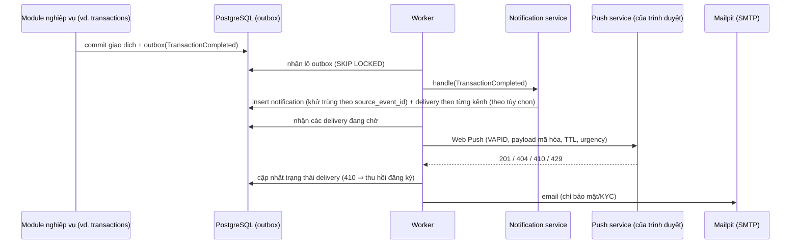

# Kiến trúc thông báo và PWA

| Mục | Giá trị |
|---|---|
| Trạng thái | Bản nháp chờ duyệt (Phase 0) |
| Cập nhật | 2026-11-21 |
| Liên quan | [Kiến trúc §4.7](architecture.md#47-xử-lý-nền), [Bảo mật §5](security.md#5-bảo-vệ-dữ-liệu) |

## 1. Luồng thông báo

- Module nghiệp vụ phát **domain event**; không bao giờ gọi trực tiếp notification service. Việc gửi tách hoàn toàn khỏi logic nghiệp vụ.
- `NotificationService.create(user, type, data)` render template (vi/en) vào `notifications`, sau đó lên kế hoạch gửi theo tùy chọn của user.
- Kênh nằm sau port `NotificationChannel`: `InAppChannel` (có dòng = đã gửi), `WebPushChannel` (`pywebpush`, khóa VAPID từ môi trường), `EmailChannel` (SMTP → Mailpit khi dev).
- Retry: backoff lũy thừa (1 phút, 5 phút, 30 phút, 2 giờ), tối đa 5 lần; 404/410 ⇒ thu hồi đăng ký; 413 ⇒ rút gọn payload; 429 ⇒ tuân theo `Retry-After`.
- Idempotency: `source_event_id` duy nhất cho mỗi notification; delivery duy nhất theo (notification, kênh, đích).

## 2. Loại và danh mục thông báo

| Danh mục | Ví dụ | Tắt push được? | In-app |
|---|---|---|---|
| TRANSACTION | nạp thành công/thất bại, nhận tiền, đã chuyển, thanh toán thành công, nhận hoàn tiền, rút thành công/thất bại | Có (trừ thất bại) | Luôn có |
| SECURITY | đăng nhập mới, đổi mật khẩu/PIN, PIN bị khóa, tài khoản bị khóa, phiên bị thu hồi, thêm tài khoản nhận tiền rút | **Không** | Luôn có |
| KYC | đã nộp, đã duyệt, bị từ chối | Có | Luôn có |
| FINANCIAL_ALERT | chạm ngưỡng ngân sách, chi tiêu bất thường (rule-based) | Có | Có (tắt được) |
| AI_INSIGHT | tóm tắt tháng | Có (mặc định tắt) | Có (tắt được) |
| SYSTEM | bảo trì, broadcast | Có | Luôn có |

Riêng tư payload push: mặc định nội dung push không có số tiền và tên đối tác ("Bạn có giao dịch mới — mở VieWallet để xem chi tiết"). Cài đặt `push_show_amounts` bật nội dung chi tiết. Payload chỉ chứa `notification_id`, danh mục và deep link; app lấy chi tiết sau khi xác thực.

## 3. Vòng đời đăng ký Web Push

1. User vào Cài đặt → Thông báo → "Bật trên thiết bị này" (không hỏi quyền ngay khi tải trang; chỉ hỏi sau thao tác chủ động của user, có màn hình giải thích trước).
2. `Notification.requestPermission()` → `registration.pushManager.subscribe({ userVisibleOnly: true, applicationServerKey: VAPID_PUBLIC })`.
3. `POST /api/v1/notifications/push-subscriptions` với endpoint + khóa + tên thiết bị. Duy nhất theo endpoint; nếu endpoint đã thuộc user khác (thiết bị dùng chung), endpoint được gán lại và liên kết cũ bị thu hồi.
4. Danh sách thiết bị trong cài đặt; xóa ⇒ thu hồi phía server + `subscription.unsubscribe()` phía client.
5. **Đăng xuất**: client hủy đăng ký và gọi `DELETE` cho endpoint này trước khi xóa session (cố gắng hết mức; server cũng thu hồi các đăng ký gắn với thiết bị của session bị thu hồi).
6. iOS/iPadOS: push chỉ hoạt động khi PWA đã được thêm vào Màn hình chính (iOS 16.4+); UI phát hiện và hiển thị hướng dẫn cài đặt.

## 4. Thiết kế PWA

| Khía cạnh | Quyết định |
|---|---|
| Công cụ | `vite-plugin-pwa` với `injectManifest` (service worker tự viết bằng TypeScript, dùng module Workbox) |
| Manifest | name "VieWallet", short_name, `display: standalone`, màu theme/background từ token, icon 192/512 + maskable, shortcut (Quét QR, Chuyển tiền) |
| Precache | App shell: HTML entry, chunk JS/CSS, font, icon, trang offline |
| Runtime cache | Tài nguyên tĩnh: CacheFirst theo revision. **`/api/*`: NetworkOnly, không bao giờ cache.** Bài help center: không cache trong MVP. |
| Cập nhật | Service worker mới chờ; UI hiển thị toast "Có phiên bản mới — Tải lại"; `skipWaiting` khi user bấm |
| Offline | Banner offline qua `navigator.onLine` + phát hiện fetch thất bại; thao tác tiền bị vô hiệu khi offline kèm thông báo rõ; không có hàng đợi offline cho thao tác tài chính (cố ý) |
| Xử lý push | Event `push` → `showNotification(title, {body, tag, data})`; `notificationclick` → focus/mở deep link; đồng thời `postMessage` tới các tab đang mở để TanStack Query làm mới số dư/thông báo |
| Cài đặt | Gợi ý cài đặt tự làm (`beforeinstallprompt`) trong Cài đặt và sau giao dịch thành công đầu tiên; màn hình hướng dẫn cho iOS |
| Đổi tài khoản | Khi đăng xuất: xóa cache TanStack Query, xóa khóa của app trong `sessionStorage`/`localStorage`, xóa IndexedDB của app, `BroadcastChannel('vw-auth')` báo các tab khác đăng xuất, hủy đăng ký push |
| Màn hình nhạy cảm | Nút "chế độ riêng tư" ẩn số dư ở trang chủ; làm mờ số dư trong trình chuyển app qua `visibilitychange` (cố gắng hết mức) |

App admin **không** phải PWA (không có service worker), giảm rủi ro lộ dữ liệu do cache trên thiết bị nhân viên.

## 5. Cập nhật thời gian thực trong app

MVP: không dùng WebSocket. Dữ liệu được làm mới qua TanStack Query (refetch khi focus/kết nối lại, polling 30 giây cho badge thông báo khi trang đang hiển thị) cộng với làm mới khi có push. Chat AI dùng HTTP streaming (fetch + ReadableStream, định dạng server-sent events trên POST). Chỉ xem xét SSE/WebSocket khi có nhu cầu thật.
