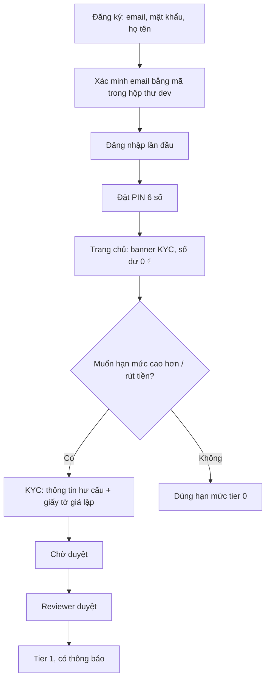
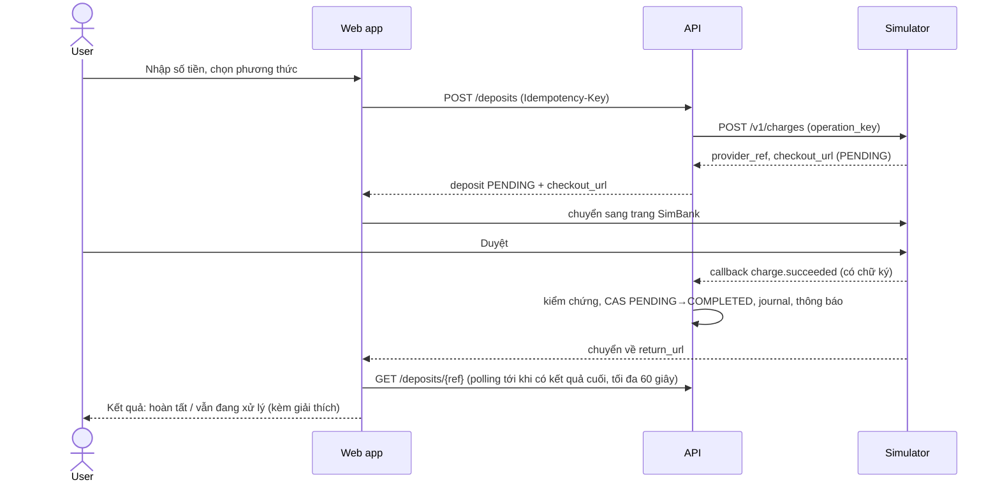

# Luồng người dùng

| Mục | Giá trị |
|---|---|
| Trạng thái | Bản nháp chờ duyệt (Phase 0) |
| Cập nhật | 2026-11-21 |
| Liên quan | [PRD](prd.md), [Design System §6](../design/design-system.md#6-danh-sách-trang), [Xử lý tài chính](../architecture/financial-processing.md) |

## 1. Bắt đầu sử dụng

## 2. Nạp tiền

## 3. Chuyển tiền

1. User mở Chuyển tiền → chọn người nhận (số ví, tra cứu SĐT/email, người nhận đã lưu, hoặc Quét QR).
2. Backend xác định người nhận và trả về tên đã che ("NGUYEN V*** A") để xác nhận.
3. User nhập số tiền và ghi chú → `POST /transfers` (báo giá): phí, tổng, hạn mức còn lại, cảnh báo (có thể trùng, người nhận mới).
4. Màn hình xem lại → PIN → `POST /transfers/{id}/confirm`.
5. Kết quả: Hoàn tất (số dư cập nhật có hiệu ứng đếm) / Đang chờ review (giải thích khoản giữ và SLA) / Thất bại (lý do + bước tiếp theo).
6. Người nhận nhận push + thông báo in-app.

Đường lỗi hiển thị nội dung cụ thể: không đủ số dư (hiện số dư khả dụng), vượt hạn mức (hiện hạn mức còn lại + gợi ý KYC), ví bị khóa, sai PIN (số lần còn lại), PIN bị khóa (thời gian còn lại + link đặt lại), báo giá hết hạn (nút báo giá lại), người nhận không khả dụng (thông báo chung).

## 4. Thanh toán QR (merchant)

1. Merchant tạo payment request (số tiền tùy chọn) → QR hiện trên màn hình merchant.
2. Khách bấm Quét → camera đọc `viewallet://pay/<code>` hoặc `https://app.../pay/<code>`.
3. App gọi `GET /payment-requests/{code}` → server kiểm tra chữ ký và trạng thái, trả về tên merchant đã xác minh, logo, số tiền.
4. Khách xác nhận → báo giá → PIN → thanh toán COMPLETED, request PAID (dùng một lần).
5. Merchant thấy thanh toán khi làm mới hoặc khi có push.

## 5. Hoàn tiền (merchant)

Merchant mở một thanh toán → Hoàn tiền → số tiền (≤ phần còn hoàn được) + lý do → `POST /merchant/payments/{ref}/refunds`. Nếu số tiền > ngưỡng (mặc định 5.000.000 ₫) ⇒ PENDING chờ Finance duyệt; ngược lại hoàn tất ngay. Khách được thông báo.

## 6. Rút tiền

Cần KYC tier 1 → chọn tài khoản nhận đã lưu (hoặc thêm mới: chờ 1 giờ) → số tiền → phí và tổng → xem lại → PIN → PENDING (tiền bị giữ) → PROCESSING → COMPLETED hoặc FAILED (hoàn tiền về ví). Timeline giải thích từng giai đoạn.

## 7. Luồng bảo mật

- **Quên mật khẩu**: email → mã/link → mật khẩu mới → thu hồi mọi phiên → thông báo.
- **Quên PIN**: mật khẩu + mã email → PIN mới → chặn rút tiền lớn 24 giờ.
- **Đăng nhập đáng ngờ**: đăng nhập từ thiết bị mới ⇒ thông báo bảo mật có nút "Không phải tôi" ⇒ thu hồi mọi phiên + bắt đặt lại mật khẩu + tự khóa ví.
- **Tự khóa ví**: Tài khoản → Bảo mật → Khóa ví (có hiệu lực ngay); mở lại cần mật khẩu + PIN.

## 8. Trợ lý AI

User hỏi "Tháng này tôi tiêu bao nhiêu cho ăn uống?" → orchestrator gọi `get_spending_by_category` → câu trả lời stream kèm data card (tổng danh mục và tỷ trọng) → hỏi tiếp "So với tháng trước?" → `get_monthly_summary` cho cả hai tháng. "Chuyển 200k cho Lan" → `draft_transfer` → tin nhắn có nút "Mở form chuyển tiền" → luồng chuyển tiền bình thường có PIN.

## 9. Admin: hoàn tiền giá trị lớn (maker-checker)

Operations (maker) mở thanh toán → đề xuất hoàn tiền kèm lý do → approval request PENDING → Finance (checker) xem tóm tắt/khác biệt và bằng chứng → Duyệt (MFA còn hiệu lực) → hệ thống thực thi payload đã lưu → hoàn tiền COMPLETED → audit cho các bước đề xuất/duyệt/thực thi.

## 10. Admin: sự cố provider

Đặt simulator sang OUTAGE → nạp tiền thất bại nhanh với `PROVIDER_UNAVAILABLE`, rút tiền đang PROCESSING chuyển sang UNKNOWN → trang Sức khỏe hệ thống báo provider đỏ → hàng đợi Operations liệt kê các thao tác không rõ kết quả → khi provider phục hồi, truy vấn trạng thái tự giải quyết → đối soát ngày hôm sau không có chênh lệch (hoặc liệt kê các mục cần xử lý).
