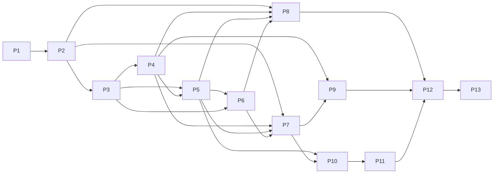

# Roadmap, phụ thuộc và tiêu chí nghiệm thu

| Mục | Giá trị |
|---|---|
| Trạng thái | Bản nháp chờ duyệt (Phase 0) |
| Cập nhật | 2026-11-21 |
| Liên quan | [Báo cáo Phase 0](00-phase0-report.md), [Chiến lược kiểm thử](quality/test-strategy.md) |

## 1. Thay đổi so với roadmap tham khảo (đề xuất)

| Thay đổi | Lý do |
|---|---|
| **Lát cắt dọc**: mỗi phase backend (2–6) giao luôn màn hình khách hàng của tính năng đó | Master prompt §20 yêu cầu có trạng thái UI mới được coi là "xong". Dồn toàn bộ UI vào Phase 7 thì phase 2–6 không kiểm chứng E2E được. Phase 7 thành "hoàn thiện app khách hàng". |
| Nền tảng design system chuyển vào Phase 1 | Từ Phase 2 trở đi cần component. |
| Lõi quy trình phê duyệt (maker-checker) chuyển vào Phase 3 | Điều chỉnh trong lõi tài chính cần nó; Phase 8 bổ sung UI admin đầy đủ. |
| Engine phí/hạn mức và **interface** risk engine ở Phase 3 (có rule mặc định thật), danh mục rule đầy đủ và công cụ admin ở Phase 6 | Chuyển tiền ở Phase 5 phải đã được kiểm tra hạn mức và rủi ro. |
| Thông báo in-app (outbox → hộp thư) ở Phase 4; Web Push + PWA ở Phase 9 | Nạp/rút cần phản hồi cho user sớm; push cần PWA. |
| **Analytics & Reporting (Phase 11 cũ) làm trước AI (Phase 10 cũ)** | Tool AI gọi service analytics; AI không được tự tính số liệu. |
| API admin xây cùng từng module (có test); **UI** admin gom vào Phase 8, trừ màn hình tối thiểu duyệt KYC/giữ tiền rủi ro nếu E2E cần sớm hơn | Giữ UX admin nhất quán mà backend mỗi module vẫn hoàn chỉnh. |

## 2. Kế hoạch phase

Quy mô: S nhỏ, M vừa, L lớn, XL rất lớn (tương đối, không cam kết lịch).

| Phase | Tên | Phụ thuộc | Quy mô |
|---|---|---|---|
| 0 | Product Discovery & Architecture | — | xong (chờ duyệt) |
| 1 | Project Foundation | 0 | xong |
| 2 | Identity & Security | 1 | xong |
| 3 | Wallet & Financial Core | 2 | xong |
| 4 | Provider Simulator, Deposit & Withdrawal | 3 | xong |
| 5 | Transfer, Payment, Refund, Reversal | 3 (4 cho đảo rút tiền) | xong |
| 6 | KYC, Risk & Limits | 3, 5 | xong |
| 7 | Hoàn thiện app khách hàng | 2–6 | xong |
| 8 | Admin & Operations | 2–6 | xong |
| 9 | Notifications (Push) & PWA | 4, 7 | M |
| 10 | Analytics & Reporting | 5, 7 | M |
| 11 | AI Financial Assistant (model miễn phí) | 10 | L |
| 12 | Testing & Hardening | tất cả | L |
| 13 | Deployment & Finalization | 12 | M |

## 3. Chi tiết từng phase

### Phase 1 — Project Foundation

Trạng thái: hoàn tất 2026-11-21, chờ chủ dự án nghiệm thu. Kết quả và các điểm lệch so với kế hoạch: [Báo cáo Phase 1](01-phase1-report.md).

**Phạm vi**
- Cấu trúc repo theo [Kiến trúc §6](architecture/architecture.md#6-cấu-trúc-repository); `.gitignore`, `.gitattributes`, `.editorconfig`, `.env.example`, cấu hình markdownlint, cập nhật CLAUDE.md.
- Khung backend (uv, Python 3.14, FastAPI, SQLAlchemy 2 async + psycopg 3, Alembic, pydantic-settings, structlog): `core` gồm config, DB engine/session/unit of work, ánh xạ lỗi → Problem Details, middleware correlation-id, logging có che dữ liệu, `Money` + tiền tệ, id UUIDv7, port clock, endpoint health, OpenAPI.
- Bảng outbox + khung worker (nhận/phát/retry/dead-letter) với một handler test; bộ chạy scheduled job.
- Idempotency store (bảng + dependency) — dùng chung, có test.
- Migration Alembic nền: `currencies`, `outbox_events`, `idempotency_keys`, function trigger chỉ-thêm; DB role.
- Frontend pnpm workspace: `apps/web`, `apps/admin`, `packages/ui`, `packages/api-client` (script sinh openapi-typescript), `packages/shared`; Vite, TS strict, Tailwind v4, React Router, TanStack Query, i18n (vi/en), ESLint/Prettier, Vitest.
- Nền design system: token (sáng/tối), font, Button, TextField, Card, Badge/StatusBadge, AmountText, Skeleton, Toast, Dialog, EmptyState/ErrorState; khung app (layout tab dưới cho khách hàng, layout sidebar cho admin); route style guide `/design`.
- Docker: Dockerfile (api/worker, web, admin), `compose.yaml` (postgres 18, redis, mailpit, migrate, api, worker, web, admin). Không cần `compose.test.yaml`: integration test dùng database `viewallet_test` trên cùng container Postgres.
- CI (GitHub Actions): backend lint/type/test với Postgres service, frontend lint/type/test/build, gitleaks, import-linter.
- Hạ tầng test: cấu hình pytest, fixture DB (schema dựng lại mỗi session, TRUNCATE bảng giữa các test — cần commit thật cho test đồng thời), factory dời sang Phase 2 khi có entity đầu tiên, profile hypothesis, khung Playwright với một smoke test.

**Tiêu chí nghiệm thu**
- `docker compose up` khởi động mọi service; `/health/ready` xanh; web và admin hiển thị khung app.
- CI xanh trên PR: lint, type check, test (gồm một integration test có DB, một test outbox, một test idempotency), build.
- Unit test cho phép tính và làm tròn của `Money`; test replay/xung đột idempotency; test retry/dead-letter của outbox.
- Chưa có tính năng nghiệp vụ; không có màn hình placeholder giả vờ có chức năng.

### Phase 2 — Identity & Security

Trạng thái: hoàn tất 2026-11-22. Kết quả và điểm lệch: [Báo cáo Phase 2](02-phase2-report.md).

User, credentials (Argon2id), đăng ký + xác minh email (Mailpit), đăng nhập, JWT access + session refresh xoay vòng, đăng xuất/đăng xuất mọi phiên, danh sách phiên, lịch sử đăng nhập, rate limit (Redis), khóa tài khoản, đặt lại/đổi mật khẩu, đổi email, bảng RBAC + seed + dependency `require()`, MFA nhân viên (TOTP) + step-up, PIN giao dịch (đặt/đổi/đặt lại/khóa), module audit (hash chain), thông báo bảo mật qua email. UI: đăng nhập, đăng ký, xác minh, quên/đặt lại mật khẩu, đặt PIN, bảo mật tài khoản, phiên; đăng nhập admin + MFA + khung admin có điều hướng theo permission.
**Nghiệm thu**: các mục auth trong danh mục test bảo mật đạt; có harness test ma trận authZ; audit cho mọi sự kiện bảo mật; không có bí mật dạng plaintext; E2E hành trình 1.

### Phase 3 — Wallet & Financial Core

Tiền tệ, ví (+ số ví), hệ thống tài khoản, journals/postings/account_balances cùng trigger và constraint, engine posting, khóa có thứ tự, mô hình giao dịch + engine state machine + event, mã tham chiếu, pricing (phí/hạn mức) với seed mặc định, interface risk engine với một phần rule ban đầu (velocity, trùng lặp, thời gian chờ), lõi quy trình phê duyệt, use case ADJUSTMENT (maker-checker), job đối soát nội bộ (I1–I5), khóa/mở khóa ví. UI: thẻ số dư trang chủ, trang ví, danh sách/chi tiết lịch sử (dữ liệu demo nạp bằng điều chỉnh).
**Nghiệm thu**: FT-23..FT-27, FT-29, FT-30 đạt; property test (thao tác điều chỉnh/chuyển ở mức domain) xanh; đối soát báo 0 vi phạm trên seed; mypy strict cho module lõi.

### Phase 4 — Provider Simulator, Deposit & Withdrawal

Service simulator (API, trang SimBank, kịch bản, callback, sao kê, điều khiển), port provider + adapter, provider operation, hộp nhận callback, job truy vấn trạng thái, use case nạp và rút với state machine đầy đủ, tài khoản nhận tiền rút, job phục hồi, thông báo in-app (hộp thư) qua outbox. UI: luồng nạp, luồng rút, tài khoản nhận, hộp thư thông báo, màn hình kết quả.
**Nghiệm thu**: FT-13..FT-19 đạt; mỗi kịch bản simulator có integration test; E2E hành trình 3 và 7.

### Phase 5 — Transfer, Payment, Refund, Reversal

Báo giá/xác nhận chuyển tiền, tra cứu người nhận (rate limit chống dò tìm), người nhận đã lưu, QR cá nhân, merchant, payment request (QR có chữ ký), quét QR, xác nhận thanh toán, xin tiền giữa người dùng, hoàn tiền (có ngưỡng phê duyệt), đảo giao dịch (maker-checker), giữ tiền do review rủi ro (API duyệt/từ chối). UI: chuyển tiền, quét, thanh toán, xin tiền, trang merchant, hoàn tiền.
**Nghiệm thu**: FT-01..FT-12, FT-20..FT-22, FT-31, FT-32 đạt; E2E hành trình 4, 5, 6.

### Phase 6 — KYC, Risk & Limits

Module KYC và quy trình duyệt, lưu trữ giấy tờ, hạn mức và trần số dư theo tier, danh mục risk rule đầy đủ, cảnh báo rủi ro, cờ tài khoản, handler giám sát bất đồng bộ, API trạng thái hạn mức, phiên bản rule qua phê duyệt. UI: luồng KYC, xem hạn mức; màn hình admin tối thiểu để duyệt nếu Phase 8 chưa bắt đầu.
**Nghiệm thu**: test vòng đời KYC; unit test từng risk rule kèm bằng chứng; E2E hành trình 2 và 8.

### Phase 7 — Hoàn thiện app khách hàng

Hồ sơ, cài đặt (ngôn ngữ, theme, chế độ riêng tư), gom trung tâm bảo mật, help center (bài viết + tìm kiếm), ticket hỗ trợ, phân loại giao dịch + sửa danh mục, xuất CSV, rà soát tiếp cận và i18n, tinh chỉnh chuyển động, rà soát trạng thái trống/lỗi.
**Nghiệm thu**: axe không có vi phạm serious; mọi trang khách hàng có đủ 7 trạng thái; điểm accessibility Lighthouse ≥ 90.

### Phase 8 — Admin & Operations

Dashboard admin (KPI từ backend), user, chi tiết user, ví, giao dịch (màn hình hồ sơ đầy đủ), hàng đợi vận hành, UI phê duyệt có xem khác biệt payload, hoàn tiền/đảo/điều chỉnh, duyệt KYC, cảnh báo/giữ tiền/rule rủi ro, đối soát (sao kê provider + mục chênh lệch + xử lý), ticket, cấu hình (phí, hạn mức, cài đặt, flag), role/permission, xem audit log + kiểm tra chuỗi hash, hoạt động admin, bảng điều khiển simulator, sức khỏe hệ thống.
**Nghiệm thu**: ma trận authZ phủ mọi endpoint admin; mọi thao tác ghi của nhân viên đều có audit; E2E hành trình 9, 10; FT-28.

### Phase 9 — Notifications (Push) & PWA

Khóa VAPID, đăng ký push, kênh Web Push, theo dõi gửi/retry, tùy chọn, template kênh email, manifest/icon, service worker tự viết (precache, NetworkOnly cho API, xử lý push, luồng cập nhật), UX cài đặt, xử lý offline, xóa dữ liệu khi đăng xuất, hướng dẫn iOS, broadcast admin.
**Nghiệm thu**: E2E push (Chromium) đạt; E2E đăng xuất (hành trình 13) đạt; service worker không bao giờ cache `/api/*` (có test).

### Phase 10 — Analytics & Reporting

View/query báo cáo, tóm tắt tháng, chi tiêu theo danh mục, theo ngày, thu nhập, giao dịch lớn nhất, phát hiện chi định kỳ, lịch sử số dư, ngân sách + cảnh báo ngưỡng, mục tiêu tiết kiệm, insight rule-based, báo cáo tài chính và hệ thống cho admin, biểu đồ kèm bảng thay thế.
**Nghiệm thu**: test tổng hợp so với fixture tính tay; đạt mục tiêu hiệu năng với 100k giao dịch; E2E cảnh báo ngân sách.

### Phase 11 — AI Financial Assistant (model miễn phí)

Port LLM provider + adapter (fake, OpenAI-compatible cho Ollama local và gói free cloud tùy chọn), dịch vụ `ollama` trong compose (profile `ai`) hoặc hướng dẫn chạy Ollama trên host để dùng GPU, benchmark chọn model local (tool calling + tiếng Việt, vừa 6 GB VRAM), orchestrator, router chọn nhóm tool, tool registry và executor, mọi tool khách hàng, tool nhân viên, hội thoại, quản lý ngữ cảnh/tóm tắt, phiên bản prompt, guardrails (quota, rate limit, xử lý injection, kiểm tra số liệu, fallback tất định), data card và bản nháp thao tác trên UI, chat UI streaming, dashboard mức sử dụng AI, bộ eval.
**Nghiệm thu**: danh mục test AI xanh với provider fake; 0 trường hợp truy cập chéo user trong test; báo cáo benchmark các model local ứng viên được ghi vào tài liệu AI; model mặc định đạt ngưỡng eval do Phase 11 đặt ra; không có thành phần trả phí.

### Phase 12 — Testing & Hardening

Bộ E2E đầy đủ, quét ZAP baseline, fuzz schemathesis, load test (k6/Locust) gồm tranh chấp ví nóng, kiểm tra dependency, rà soát threat model, sửa lỗi, đồng bộ tài liệu.
**Nghiệm thu**: không còn phát hiện critical/high mở; NFR-04 và NFR-07 được đo và đạt.

### Phase 13 — Deployment & Finalization

Môi trường production-like với reverse proxy TLS, hostname riêng, quản lý bí mật, backup, dashboard giám sát, release notes, review kiến trúc cuối, kịch bản demo và README portfolio. Ưu tiên phương án hosting miễn phí.
**Nghiệm thu**: triển khai sạch từ đầu theo tài liệu deployment; kịch bản demo chạy hết từ đầu đến cuối.

## 4. Tiêu chí nghiệm thu chung (Definition of Done)

Xem master prompt §20 và [Chiến lược kiểm thử §8](quality/test-strategy.md#8-tiêu-chí-nghiệm-thu-phase-definition-of-done-cho-mỗi-module). Báo cáo mỗi phase liệt kê: phạm vi đã giao, test đã chạy (kèm kết quả), kết quả lint/type/build, vấn đề còn tồn tại, tài liệu đã cập nhật, quyết định đã đưa ra.
